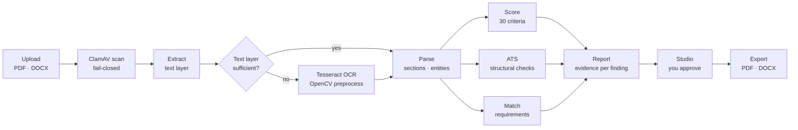
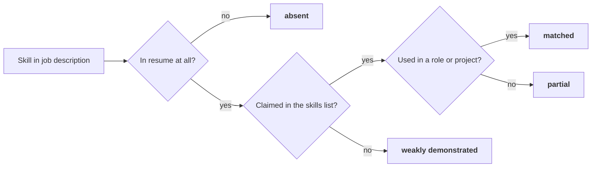
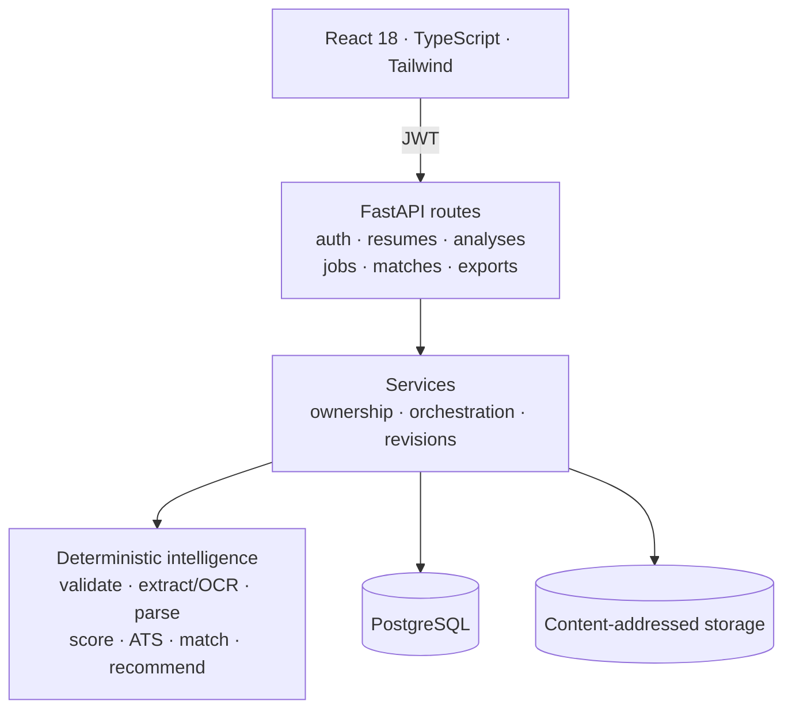

<div align="center">


### Beyond Your Resume. Unleash Your Potential.

**Resume intelligence with a receipt for every point.**

Deterministic scoring · ATS compatibility · job matching · edits you approve.

[](docs/TESTING.md)
[](docs/API.md)
[](docs/SCORING_METHODOLOGY.md)
[](docs/PROJECT_STATUS.md)
[](LICENSE)

</div>


<p align="center"><sub>Real product, real analysis — captured by <code>scripts/capture_screenshots.mjs</code> against a seeded demo account (a separate run from the measured sample in §03). Nothing mocked.</sub></p>

---

## 01 — The thesis

Every resume tool gives you a number. Almost none can tell you which sentence cost you a point, and fewer still will refuse to invent one.

POTENCIA is built on one constraint: **the score is arithmetic over evidence, not an opinion.**

| The question | The mechanism | The receipt |
|:--|:--|:--|
| Is this resume any good? | 30 criteria across 6 weighted categories | Category score, weight and contribution |
| Will software read it? | Structural ATS estimate, 5 checks | Pass / warn / not-applicable per check |
| Does it fit *this* job? | Requirement extraction + four-outcome skill matching | Matched, partial, absent — never collapsed |
| What do I fix first? | Findings sorted by points lost | Verbatim source line + a concrete remedy |

**Numbers come from rules. Prose may come from a model.** No provider, SDK or network call sits in the scoring path. AI rewrites are optional, schema-validated and can never move a score.



---

## 02 — Inside the product

<table>
<tr>
<td width="50%" valign="top">
<br/>
<b>Report.</b> Overall score, category breakdown, ATS estimate and the priority queue — every deduction carrying its source line.
</td>
<td width="50%" valign="top">
<br/>
<b>Job match.</b> <i>Partial</i> is its own state: claimed in the skills list, never demonstrated in a role.
</td>
</tr>
<tr>
<td width="50%" valign="top">
<br/>
<b>Studio.</b> Edit summary, bullets, skills, projects and education. A save creates a revision; it never overwrites the original.
</td>
<td width="50%" valign="top">
<br/>
<b>Recommendations.</b> Rewrites where the text supports one, questions where it does not.
</td>
</tr>
</table>

<details>
<summary><b>Export, history and landing screens</b></summary>

<table>
<tr>
<td width="50%" valign="top"><br/><b>Export.</b> Pick a named version; download PDF or DOCX through a signed 15-minute URL.</td>
<td width="50%" valign="top"><br/><b>History.</b> Resumes and analyses, newest first, with keyset cursors.</td>
</tr>
<tr>
<td colspan="2" valign="top"><br/><b>Landing.</b> The commitments, stated before the product asks for a file.</td>
</tr>
</table>

</details>


<p align="center"><sub>The exported report is rendered from the stored analysis — scores, weights, ATS checks and the finding queue. Every generated document is re-opened and checked by a parser in the test suite.</sub></p>

---

## 03 — One document, measured end to end

A single resume — **87 words, 2 roles, 4 bullets, 7 listed skills** — through the finished pipeline against PostgreSQL. Source: [`assets/readme/metrics.json`](assets/readme/metrics.json), produced by `scripts/readme_metrics.py`.

<table>
<tr>
<td width="50%" valign="top">

**What the parser recovered**

| Field | Value |
|:--|--:|
| Words / bullets | 87 / 4 |
| Experience entries | 2 |
| Explicit / inferred skills | 7 / 1 |
| Extraction | text layer |
| **Overall score** | **82.6 / 100** |
| Band | strong |

</td>
<td width="50%" valign="top">

**What the engines concluded**

| Metric | Value |
|:--|--:|
| ATS compatibility | **88.2 / 100** |
| Criteria measured | 30 |
| Findings | 13 (2 high · 6 medium · 5 low) |
| Priority actions | 5 |
| Recommendations | 13 |
| Job match | **49.0 / 100** |

</td>
</tr>
</table>

The report reconciles with itself: the 13 findings' impacts sum to **17.4 points**, exactly `100 − 82.6`. That identity is a test, not a slogan — if the findings stop explaining the score, CI fails.

---

## 04 — The scoring model

```
overall = 100 × Σ(category_score × weight) / Σ(weight of applicable categories)
```

| Category | Weight | Sample | Contribution |
|:--|--:|--:|--:|
| Content quality | 25 | 78.4 | 19.60 |
| Experience & achievements | 20 | 86.9 | 17.38 |
| Structure & organisation | 15 | 100.0 | 15.00 |
| ATS compatibility | 15 | 88.2 | 13.23 |
| Skills presentation | 15 | 66.2 | 9.93 |
| Language & readability | 10 | 74.5 | 7.45 |
| **Total** | **100** | | **82.59 → 82.6** |


**Why this structure holds together**

1. **Missing is not zero.** A category that does not apply leaves the denominator. A first-time candidate with no work history is scored on what they presented, with `applicable_weight: 80` stated plainly — not punished for a section they never had.
2. **Every deduction cites text.** An applicable criterion below 1.0 must emit a finding with a verbatim excerpt. The aggregator raises rather than reporting an unexplained deduction.
3. **Evidence is measured in whole mentions.** Skill checks reuse the taxonomy's boundary-aware matcher, so `R` is not "found" inside `worked`, and aliases such as `JS` still match `JavaScript`. A summary mention is a claim, not demonstrated use.
4. **Confidence is an output.** Extraction quality lowers category confidence and caps the ATS estimate, so a badly-read scan cannot present as a clean document.
5. **No model in the number.** The only clock input is the UTC calendar year for recency and career-span checks; no randomness, sampling or third-party call. Stored analyses keep the methodology version that produced them.

The top band is gated too: a resume cannot reach **Exceptional** with weak quantification (CQ-03) or unverifiable skills (SK-04), whatever the arithmetic says. Full rubric: [`docs/SCORING_METHODOLOGY.md`](docs/SCORING_METHODOLOGY.md).

---

## 05 — Findings are a work queue, not a warning list


Findings are ordered by **points lost**, then severity, so the first action buys the most. The top of the real queue on the 82.6 sample:

| Points | Severity | Criterion | Finding | Evidence quoted |
|--:|:--|:--|:--|:--|
| −3.12 | high | CQ-03 | Achievements are described but not measured | *"Worked on latency improvements"* |
| −2.98 | high | SK-04 | Skills claimed but never demonstrated | *"Django, PostgreSQL, Docker, AWS, Kubernetes, Redis"* |
| −1.76 | medium | AT-04 | Date formats are mixed | *"month, year"* |
| −1.71 | medium | SK-05 | Skills not evidenced recently | *"Python"* |
| −1.43 | medium | EX-05 | Claimed skills disconnected from experience | *"aws, django, docker, kubernetes, postgresql"* |

An unquantified achievement never produces a guessed number. It produces a question: *"What scale did this work operate at — records, requests per day, users, revenue, or time saved? Add the real figure."*

---

## 06 — Calibration: measured, and honestly bounded

`scripts/calibrate.py` parses eight fixtures with the real parser, scores them with the real engine, and compares five weight vectors against the rubric's tiers.

| Candidate | Spearman ρ | Pairwise accuracy | Tier spread |
|:--|--:|--:|--:|
| **shipped (v1.2.0)** | **0.909** | **0.920** | **39.4** |
| equal-weights | 0.909 | 0.920 | 40.0 |
| ATS-heavy | 0.909 | 0.920 | 34.3 |
| content-heavy | 0.873 | 0.880 | 40.7 |
| experience-heavy | 0.873 | 0.880 | 37.7 |


**The honest reading.** No alternative beats the shipped vector on rank agreement. Two tie it (equal-weight and ATS-heavy), and equal-weight has a marginally larger tier spread (40.0 vs 39.4). Eight authored fixtures cannot distinguish these vectors, so the weights remain a **documented product-design choice**, not an optimised or validated result. The corpus spans 46.4 – 88.3; the raw output is in [`calibration.json`](assets/readme/calibration.json), including that caveat.

What would justify a stronger claim is a study, not more fixtures: ≥ 200 consented resumes, two independent raters per resume (target weighted Cohen's κ ≥ 0.7), fitted weights and a held-out test set. That protocol is written down in §9 of the methodology and executable: `scripts/calibration_study.py` validates consent, anonymisation and every rating, reports inter-rater agreement before any engine number, splits deterministically by SHA-256 of the sample id, fits only on the training half and evaluates the holdout once. It refuses a smaller or unconsented corpus, and it never edits the shipped weights.

---

## 07 — Matching: four outcomes, never two

Most tools collapse this into match / no-match, then tell people to add skills they already have. POTENCIA keeps every distinction the evidence supports.



On the sample job description — 4 required, 2 preferred — the result is **49.0**:

| Requirement | Status | Meaning |
|:--|:--|:--|
| Python | matched | Listed *and* used in a bullet |
| PostgreSQL | partial | Listed, never demonstrated |
| Kubernetes | partial | Listed, never demonstrated |
| Terraform | absent | Nowhere in the document |
| Kafka *(preferred)* | absent | Nowhere in the document |
| GraphQL *(preferred)* | absent | Nowhere in the document |

The low number is the finding, not a bug: the candidate claims seven technologies and demonstrates one. The gap advice says *"do not add it unless you have genuinely used it."*

---

## 08 — ATS compatibility: an estimate, stated as one

| Check | Sample | Why it matters |
|:--|:--|:--|
| AT-01 Extraction fidelity | pass | If text does not extract, nothing downstream survives |
| AT-02 Reading order | pass | Columns reflow in unpredictable order |
| AT-03 Structural hazards | *n/a* | The parser reported no hazards; assuming none would be a guess |
| AT-04 Date parseability | **warn** | Mixed formats are readable here, fragile elsewhere |
| AT-05 Contact parseability | pass | Email and phone are recoverable as text |

3 pass, 1 warn, 1 not applicable → **88.2**. Extraction confidence below 0.5 caps the estimate at 55 no matter how tidy the layout looks, and a check that cannot be evaluated leaves the denominator.

> ATS compatibility estimate. Not a prediction of screening outcomes.

The disclaimer travels with the number in the API payload, the report and the PDF.

---

## 09 — Performance, measured

`scripts/profile_engine.py` — 200 warm runs over eight documents, no HTTP, no database, no network:

| Stage | p50 | p95 | p99 |
|:--|--:|--:|--:|
| Parse | **1.13 ms** | 1.27 ms | 1.45 ms |
| Score (30 criteria) | **1.26 ms** | 1.67 ms | 2.30 ms |
| Parse + score | **2.10 ms** | 2.38 ms | 3.60 ms |
| Job match (12 requirements) | **0.05 ms** | 0.06 ms | 0.07 ms |
| Recommendations | **0.04 ms** | 0.05 ms | 0.05 ms |
| **Full pipeline** | **2.09 ms** | 2.35 ms | 3.73 ms |

Cold start: 1.69 ms to parse, 2.32 ms to score. Sequential stage measurements share a shifting CPU clock, so the full pipeline is the stable number.


Cost per kilobyte flattens with document size (2.05 → 1.64 ms/KB across an 8× range) and matching is linear in requirement count. Neither is accidental: the heading table is ordered once at import, and the resume is prepared once per match instead of once per requirement.

| Request path (HTTP + PostgreSQL, 20 runs) | p50 |
|:--|--:|
| Upload + parse | 38.2 ms |
| Analysis, first call | 34.5 ms |
| Analysis, steady | **16.7 ms** (p95 20.7) |
| Recommendations | 68.8 ms |
| Job match | 32.3 ms |
| PDF report export | 112.1 ms |


Under **8 concurrent clients / 200 analyses** (`scripts/load_test.py`): **200 / 200 completed**, 3.31 s wall time, **60.5 analyses/s**, p50 **90.4 ms**, p95 129.7 ms, p99 189.1 ms. The same script measured 77.4 analyses/s on this host earlier, so this is a cost bound, not a capacity plan. Absolute milliseconds track CPU clock; ratios transfer better than microseconds.

---

## 10 — Hardening and reliability

A resume upload is untrusted binary data, so it is treated that way before any text is read.

| Control | Behaviour |
|:--|:--|
| File identity | Extension, magic bytes and MIME must agree; renamed executables refused |
| Malware | Streamed to ClamAV `INSTREAM` before storage; fail-closed in production |
| Container abuse | Caps on PDF pages, DOCX entries and compression ratio; macros and encrypted PDFs refused |
| Storage | Content-addressed SHA-256, mode `0600`, no path returned to a client |
| Auth | bcrypt; 15-min access JWT, 14-day refresh, `token_version` revocation |
| Isolation | Row-level `user_id`; another account's resource returns `404` |
| Downloads | HMAC-signed, account-bound, 15-minute capability URL |
| Double submits | `X-Idempotency-Key` replays for 24 h; cross-endpoint reuse is `409` |
| Paging | Keyset cursors on UUIDv7 — no duplicates or skips mid-walk |
| Retention | Exports expire in 24 h; a scheduled service deletes files **and** rows |
| Failures | Uniform error envelope with a request id; no stack traces leave the server |

Scanned PDFs take an OCR fallback only when the text layer is unusable: render at 200 DPI, grayscale + CLAHE + denoise + deskew, Tesseract, then mean word confidence feeds the extraction confidence the scorer already uses. An ordinary digital PDF never pays that cost.

**Measured on one reproducible synthetic scan** (200 DPI, 1.3° skew, σ7 noise, JPEG 65, Tesseract 5.3.4): 161/161 words recovered (F1 1.000), score 92.1 → 91.8, ATS 88.2 → 86.5, OCR p50 525 ms versus 1.19 ms for text-layer extraction. One fixture — a shape and a cost, not a scanner benchmark. See [`ocr_profile.json`](assets/readme/ocr_profile.json).

---

## 11 — Architecture



| Layer | Stack |
|:--|:--|
| Web | React 18 · TypeScript strict · Vite 5 · Tailwind · TanStack Query |
| API | FastAPI · Pydantic v2 · SQLAlchemy 2 · Alembic · Python 3.12 |
| Data | PostgreSQL 16 · Redis for shared rate-limit counters |
| Documents | PyMuPDF · python-docx · Tesseract + OpenCV OCR · ReportLab |
| Hardening | ClamAV · container-abuse limits · SHA-256 storage |
| AI (optional) | Gemini via `google-genai` — rewrites only, never scoring |
| Delivery | Docker · Compose · GitHub Actions · structured JSON logs |

**37 API operations across 29 paths**, all under `/api/v1` except health. The deterministic engine lives in `backend/app/intelligence/`; document handling in `backend/app/document/`; every measurement and artefact in `scripts/`. Contracts: [`docs/API.md`](docs/API.md).

---

## 12 — Run, test, reproduce

```bash
git clone https://github.com/tdzoro/Potencia && cd Potencia
cp .env.example .env            # set POTENCIA_SECRET_KEY
docker compose up --build       # API :8000 · web :8080 · PostgreSQL · Redis · ClamAV :3310
```

`GEMINI_API_KEY` and `SMTP_*` are optional; without them the product is rules-only and logs verification links instead of emailing them. Local backend setup: `python -m venv .venv`, `pip install -r requirements.txt`, `alembic upgrade head`, `uvicorn app.main:app --reload`; the frontend runs with `npm install && npm run dev`.

```bash
cd backend && pytest                 # 278 collected · 273 pass · 5 optional skips
cd frontend && npm test              # 33 component and form tests
cd frontend && npm run build         # strict typecheck + production build
cd frontend && npm run e2e           # 15 browser journeys against a live stack
```

Tests that exist to stop the product lying:

- **Reconciliation** — `sum(findings.score_impact) == 100 − overall` within 0.15.
- **Impact order** — findings and priority actions descend by points lost.
- **Evidence** — every finding carries a verbatim excerpt; `R` is not substantiated by "worked".
- **Honesty** — no invented metrics, and *partial* never collapses into *absent*.
- **Immutability** — revision 0 stays byte-identical; a replayed create writes no second row.
- **Efficiency** — one document read per match; no heading sort per line.

CI separately starts ClamAV and runs the live-daemon tests (`tests/test_clamav_integration.py`). It runs on every push and pull request, plus a Monday 06:00 UTC schedule, so the full backend, PostgreSQL migration round trip, frontend checks and browser suite are retested even when nothing is pushed. The browser suite seeds its own account and asserts the score from the DOM, accepts a recommendation, verifies a signed PDF link, produces a named job gap and exports a named version.

### Reproduce every figure

Each script writes raw output next to the chart. Nothing here was typed by hand.

| Script | Measures | Writes |
|:--|:--|:--|
| `readme_metrics.py` | one real upload → analysis → recommendations → match → exports | `metrics.json`, `latency.png`, `findings.png` |
| `profile_engine.py` | per-stage cost, cold start, size and requirement scaling | `engine_profile.json` |
| `calibrate.py` | five weight vectors against eight rubric-ranked fixtures | `calibration.json` |
| `calibration_study.py` | consent-gated 200+ resume study: κ, fixed split, fitted weights | caller-chosen JSON |
| `load_test.py` | 200 analyses across 8 concurrent clients | `load.json` |
| `measure_ocr.py` | OCR cost, word recovery and score drift on a synthetic scan | `ocr_profile.json` |
| `readme_charts.py` + capture scripts | charts from the JSON; UI screenshots and the report page | `*.png` |

```bash
PYTHONPATH=backend backend/.venv/bin/python scripts/profile_engine.py
PYTHONPATH=backend backend/.venv/bin/python scripts/calibrate.py
PYTHONPATH=backend backend/.venv/bin/python scripts/readme_charts.py
```

Docs: [SRS](docs/SRS.md) · [Architecture](docs/ARCHITECTURE.md) · [API](docs/API.md) · [Scoring methodology](docs/SCORING_METHODOLOGY.md) · [Security](docs/SECURITY.md) · [Testing](docs/TESTING.md) · [Status](docs/PROJECT_STATUS.md) · [QA report](docs/QA_REPORT.md).

---

## 13 — Limits, stated up front

- **The weights are not empirically validated.** A reproducible harness shows the shipped vector is not beaten on eight rubric-ranked fixtures; two vectors tie it. The 200-resume study harness exists but has not been run on a real corpus, so the weights remain a product-design choice.
- **The ATS score simulates no specific vendor.** It measures structural parseability — the honest shared denominator.
- **AI is optional and never scores.** Without a key the product is entirely rules-driven; with one, proposals are schema-validated and fall back on failure.
- **Recency and length checks use the UTC calendar year.** The same input in the same year yields the same score; an explicit later re-analysis can differ, and stored analyses are never silently recalculated.
- **OCR needs the Tesseract binary.** Without it, a scanned document returns `ocr_not_performed` rather than pretending to read it. The recorded test covers one synthetic scan.
- **ClamAV is optional outside production.** In development an unscanned upload is accepted and marked `scanned: false`; production refuses it with `503`.
- **Email needs SMTP.** Without it, verification and reset links are logged in a hermetic in-memory mode.
- **Performance is single-host.** One process, one PostgreSQL, no capacity claim.
- **Version comparison** covers summary, skills, experience bullets, projects and education; certifications, achievements and leadership lines are carried and exported but not diffed field by field.

---

<div align="center">

**POTENCIA** · Resume intelligence you can audit

Built by [Arghya Bose](https://github.com/tdzoro) · © 2026 POTENCIA Team · All rights reserved

[Licence](LICENSE) · [Methodology](docs/SCORING_METHODOLOGY.md) · [API](docs/API.md)

</div>
