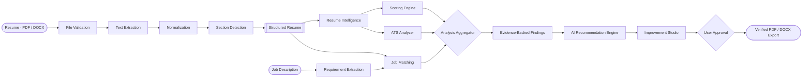
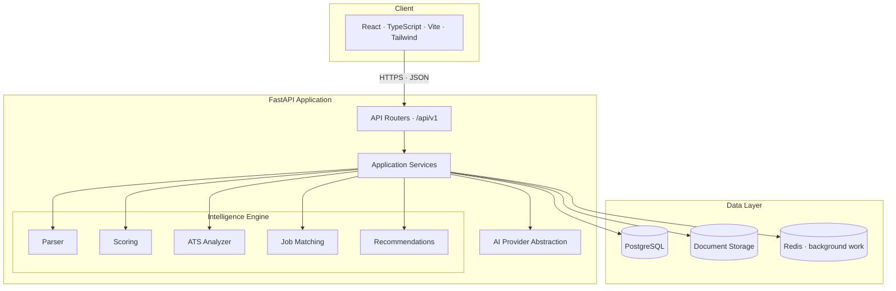

<div align="center">


<br />

# POTENCIA

### AI Resume Intelligence

**Beyond Your Resume. Unleash Your Potential.**

<br />


<br />
<br />

[Overview](#overview) · [Capabilities](#capabilities) · [Intelligence](#the-intelligence-pipeline) · [Scoring](#explainable-scoring) · [Architecture](#system-architecture) · [Status](#repository-status) · [Documentation](#documentation)

</div>

---

## Overview

**POTENCIA** is a resume intelligence platform. It reads a real resume, reconstructs its structure, measures it against explicit criteria, and returns analysis a candidate can actually act on — with the evidence attached.

It is not an "upload and get a number" website. Every score is produced by a deterministic, reproducible rule engine over extracted document data. Language models are used where they belong: to explain a finding, to propose a rewrite, to make the result readable — never to invent the number, and never to invent facts about a person's career.

POTENCIA exists to answer five questions honestly:

<table>
<tr>
<td width="50%" valign="top">

**01 — Strength**
How strong is this resume, measured against explicit criteria?

**02 — Parsing**
How reliably can ATS-style software read and structure it?

**03 — Relevance**
How well does it match a specific target role?

</td>
<td width="50%" valign="top">

**04 — Weakness**
What exactly is reducing its effectiveness, and where?

**05 — Action**
What should change, in what order, and why?

</td>
</tr>
</table>

> **On ATS:** POTENCIA produces an *ATS compatibility estimate*. It does not simulate proprietary vendor systems, and it never promises a screen pass, an interview, or a job. Claiming otherwise would be dishonest, so the product does not.

---

## Capabilities

The platform is scoped across ten modules. Each one is a separate, independently testable unit — never a branch inside a monolith.

| # | Module | Responsibility |
|:-:|---|---|
| **A** | **Document Processing** | PDF/DOCX validation, text extraction, page and section detection, extraction confidence, scanned-document detection with OCR as a controlled fallback |
| **B** | **Resume Intelligence** | Structured understanding of contact, summary, education, experience, internships, technical and soft skills, projects, certifications, achievements, leadership |
| **C** | **ATS Compatibility** | Readability, heading clarity, column and table risk, headers/footers, symbol and font anomalies, date consistency, reading order |
| **D** | **Scoring Engine** | Seven independently explainable scores, each with documented criteria, weights, evidence and confidence |
| **E** | **Job Matching** | Requirement extraction and evidence-backed comparison: matched, partially matched, missing, and weakly demonstrated |
| **F** | **Recommendations** | Weak bullet detection, stronger action verbs, quantification prompts, summary and grammar improvements — grounded in the resume, never fabricated |
| **G** | **Improvement Studio** | Side-by-side original versus improved editing, per-item accept/reject, full revision history, original content preserved |
| **H** | **Analysis Dashboard** | Overall score, breakdown, ATS estimate, job match, strengths, weaknesses, missing keywords, prioritized next actions |
| **I** | **Reports & Export** | Analysis reports and improved resumes as PDF and DOCX, verified for layout integrity — not merely written to disk |
| **J** | **Accounts & Data** | Registration, login, resume and analysis history, deletion and privacy controls, strict per-user data isolation |

---

## The Intelligence Pipeline



The pipeline is deliberately asymmetric: **deterministic analysis is the spine, generation is the finish.** Findings are produced before any model is called, so every suggestion can cite the resume text that triggered it.

### Three independent layers

| Layer | Owns | Never does |
|:--|:--|:--|
| **Deterministic** | Extraction, section identification, rule-based checks, score arithmetic, date validation, document geometry | Guess. Ambiguity is recorded as ambiguity. |
| **NLP** | Skill normalization, canonical taxonomy mapping, semantic similarity, keyword context, requirement matching | Treat a passing keyword as proof of expertise |
| **Generative** | Explanation, rewrite proposals, summaries, user-facing insight | Decide a numerical score, or invent a metric, employer, degree, certification or skill |

Each layer is testable in isolation. A failure in one never silently corrupts another.

---

## Explainable Scoring

Weights below are **product-design starting points**, not empirically validated industry standards. They are versioned in the methodology document and will be calibrated against an annotated corpus and expert review — and we will say so when they change.

| Category | Weight | Evidence basis |
|:--|--:|:--|
| Content Quality | 25 | Summary presence and density, bullet construction, specificity, achievement framing |
| Experience & Achievements | 20 | Role clarity, chronology integrity, quantification rate, scope signals |
| Skills Presentation | 15 | Taxonomy coverage, grouping, redundancy, unverifiable claims |
| Structure & Organization | 15 | Standard sections, ordering, heading clarity, length discipline |
| ATS Compatibility | 15 | Extraction fidelity, layout complexity, reading order, contact parseability |
| Language & Readability | 10 | Grammar, passive voice, tense consistency, verb variety, sentence length |
| **Total** | **100** | |

**Contract for every score:**

- Reproducible — identical input and methodology version yield an identical score. No sampling, no variance.
- Evidence-cited — every deduction names the resume line that caused it.
- Fair when incomplete — *not applicable* is distinguished from *missing*; a section is never double-penalized.
- Transparent — criterion-level breakdown, not a single opaque integer.
- Versioned — every stored analysis records the methodology version that produced it.

A `Job Match Score` is reported **separately** and never folded into the resume's intrinsic quality, because a resume is not "worse" for targeting a different role.

---

## System Architecture



The frontend holds no AI credentials and no storage URLs. Providers sit behind an abstraction so a model can be swapped without touching business logic, and document parsing, scoring, AI orchestration and API routing never share a module.

<details>
<summary><b>Target repository layout</b></summary>

```text
POTENCIA/
├── frontend/                  # React + TypeScript SPA
│   └── src/{components,pages,layouts,hooks,services,context,types,utils,styles}
├── backend/
│   └── app/
│       ├── api/               # routers · dependencies
│       ├── core/              # config · security · logging
│       ├── models/ schemas/ repositories/ services/
│       ├── intelligence/      # parser · normalization · scoring
│       │                      # ats · matching · recommendations · evaluation
│       ├── ai/                # providers · prompts · schemas · orchestration
│       ├── document/          # extraction · validation · ocr · export
│       ├── tasks/  tests/  main.py
│       └── migrations/
├── shared/                    # api-contracts · fixtures
├── docs/                      # specification and methodology
├── assets/brand/              # identity
└── docker-compose.yml
```

</details>

---

## Engineering Principles

The rules this codebase is accountable to:

<table>
<tr>
<td width="50%" valign="top">

**Correctness**
- No fabricated resume content — ever
- No random or LLM-decided scores
- No silent parsing failures
- No fake analysis results in production paths
- No unsupported accuracy claims

</td>
<td width="50%" valign="top">

**Discipline**
- Every feature ships with tests
- Every endpoint validates and handles failure
- No non-functional UI controls
- Secrets never enter source control
- No phase advances on failed exit criteria

</td>
</tr>
</table>

When something breaks: reproduce it, find the root cause, fix the cause, add a regression test, verify. Workarounds that hide a defect are treated as defects.

---

## Repository Status

> **Current phase: 0 — Repository Audit (complete).**
> The repository contains its identity, its audit and its specification. Application code begins in Phase 2 (Foundation); nothing above is claimed as built yet.

| Phase | Objective | Status |
|:-:|:--|:-:|
| 0 | Repository audit & implementation plan | ✅ |
| 1 | Product specification & system design | ○ |
| 2 | Foundation: FastAPI, React, Docker, health checks | ○ |
| 3 | Database, authentication, data isolation | ○ |
| 4 | Document ingestion & parsing engine | ○ |
| 5 | Resume intelligence & understanding | ○ |
| 6 | Explainable scoring engine | ○ |
| 7 | ATS compatibility engine | ○ |
| 8 | Job description matching | ○ |
| 9 | AI recommendation engine | ○ |
| 10 | Resume improvement studio | ○ |
| 11 | Frontend product experience | ○ |
| 12 | PDF & DOCX report generation | ○ |
| 13 | Security & privacy hardening | ○ |
| 14 | QA & full test suite | ○ |
| 15 | Performance & reliability | ○ |
| 16 | Production deployment | ○ |

Live detail — files changed, tests run, known bugs, technical debt, blockers — lives in [`docs/PROJECT_STATUS.md`](docs/PROJECT_STATUS.md).

---

## Technology

| Layer | Stack |
|:--|:--|
| **Frontend** | React · TypeScript · Vite · Tailwind CSS · React Router · TanStack Query · React Hook Form · Zod · Recharts |
| **Backend** | Python 3.12 · FastAPI · Pydantic · SQLAlchemy · Alembic |
| **Data** | PostgreSQL · Redis (background work) |
| **Documents** | PyMuPDF · pdfplumber · python-docx · OCR fallback |
| **Intelligence** | Rule-based scoring · spaCy · sentence-transformers · skill taxonomy · provider-agnostic LLM orchestration |
| **Infrastructure** | Docker · Docker Compose · GitHub Actions · structured logging |

### Verified development toolchain

The audit environment already carries Node `22.16.0`, npm `10.9.2`, Python `3.12.3`, Docker `29.9.2` with Compose `v5.6.1`. PostgreSQL and Redis are provisioned through Compose rather than installed on the host, so no local database setup is required. Bootstrap commands are published with the Phase 2 foundation.

---

## Documentation

| Document | Contents | State |
|:--|:--|:-:|
| [`docs/REPOSITORY_AUDIT.md`](docs/REPOSITORY_AUDIT.md) | Audit, technical debt, architecture proposal, implementation sequence | ✅ |
| [`docs/PROJECT_STATUS.md`](docs/PROJECT_STATUS.md) | Phase tracker, tests executed, known issues, debt, blockers | ✅ |
| `docs/SRS.md` | Software requirements specification | Phase 1 |
| `docs/ARCHITECTURE.md` | Component boundaries and data flow | Phase 1 |
| `docs/API.md` | Versioned REST contracts | Phase 1 |
| `docs/SCORING_METHODOLOGY.md` | Criterion definitions, weights, calibration record | Phase 1 |
| `docs/SECURITY.md` | Threat model, controls, privacy policy | Phase 13 |
| `docs/TESTING.md` | Test strategy, fixtures, evaluation datasets | Phase 14 |

---

## Privacy

A resume is one of the most personal documents a person owns. POTENCIA treats it that way:

- Uploaded resumes are **never** public, never indexed, and never cross-user readable.
- Resume contents are **never** written to logs.
- Users can delete a resume, an analysis, or their account — and that deletion is real.
- Only the minimum necessary text is sent to an external AI provider; document content is handled as untrusted **data**, never as instructions (prompt injection is treated as an input class, not an edge case).
- Retention is bounded and documented, not indefinite by accident.

Full commitments land with `docs/SECURITY.md` in Phase 13.

---

<div align="center">

<br />


**POTENCIA** — *Beyond Your Resume. Unleash Your Potential.*

`Upload → Understand → Evaluate → Match → Improve → Export`

<br />

Released under the [MIT License](LICENSE).

</div>
