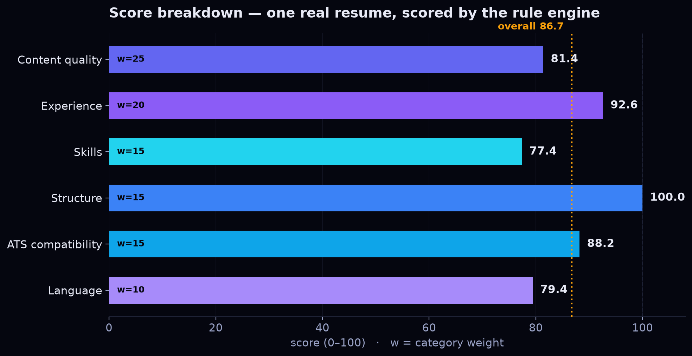
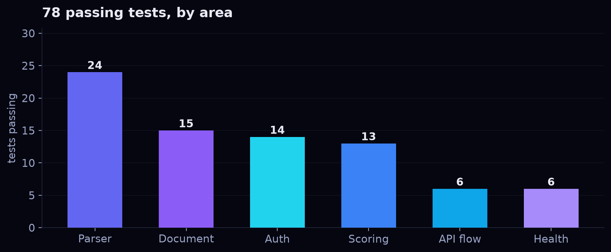
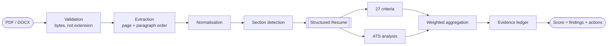
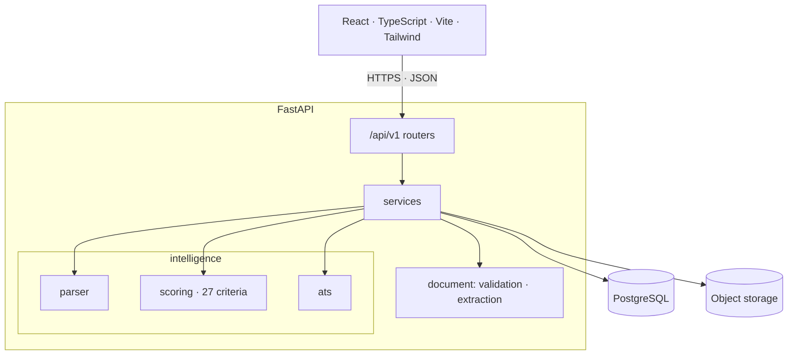

<div align="center">


<br /><br />

# POTENCIA

**AI Resume Intelligence**

*Beyond Your Resume. Unleash Your Potential.*

<br />


<br /><br />

[Result](#-measured-not-claimed) · [How it works](#-the-intelligence-pipeline) · [Theory](#-the-scoring-theory) · [API](#-api-surface) · [Quickstart](#-quickstart) · [Status](#-status)

</div>

---

## ⚡ What this is

POTENCIA reads a resume, reconstructs its structure, and measures it against **27 explicit criteria** across six weighted categories. Every number is produced by deterministic rules — a language model never decides a score.

Instead of "your resume is 7/10", you get a ledger: here is the score, here is the exact sentence that cost you points, here is what to change, and here is what it is worth.

> **The product thesis.** Most resume tools ask a model to *rate* a document. That produces variance (the same resume scores differently tomorrow), opacity (nobody can tell which line mattered), and manipulation (flattering text scores well). POTENCIA inverts it: **numbers come from rules, prose comes from models.**

---

## 📊 Measured, not claimed

Every figure below was produced by running the real engine, over real HTTP, against real PostgreSQL — while writing this README.

### One real resume, end to end

| Stage | Result | Detail |
|:--|:--|:--|
| Upload → parse | **66 ms** | 1-page PDF, text layer, extraction confidence **1.00** |
| Reconstructed structure | **2 roles · 4 bullets · 7 explicit skills · 107 words** | plus 1 skill *inferred* from prose, never promoted to a claim |
| Full analysis | **45 ms** first run · **22.4 ms** p50 | parse → 27 criteria → ATS → 11 findings |
| Overall score | **86.7 / 100** — *strong* | `applicable_weight: 100` — every category applied |



| Category | Score | Weight | Confidence |
|:--|--:|--:|:--|
| Content quality | 81.4 | 25 | high |
| Experience & achievements | 92.6 | 20 | high |
| Skills presentation | 77.4 | 15 | high |
| Structure & organization | 100.0 | 15 | high |
| ATS compatibility | 88.2 | 15 | high |
| Language & readability | 79.4 | 10 | high |
| **Overall** | **86.7** | **100** | high |

### ATS compatibility — an estimate, labelled as one

| Check | Status | Finding |
|:--|:-:|:--|
| AT-01 Extraction fidelity | ✅ pass | full text layer recovered |
| AT-02 Reading order | ✅ pass | single column, order preserved |
| AT-03 Structural hazards | ✅ pass | no tables, text boxes or image text |
| AT-04 Date parseability | ⚠️ warn | mixed formats across roles |
| AT-05 Contact parseability | ✅ pass | email and phone recover as plain text |

**Estimate: 88.2** · `3 pass · 1 warn · 0 fail` · the response carries its own mandatory disclaimer, so no client can render the number without the caveat.

### Every deduction is traceable


Eleven findings, each carrying verbatim evidence, an explanation and a remediation:

- **[high] CQ-03** — *"Achievements are described but not measured"* · −3.12 pts
- **[medium] AT-04** — *"Date formats are mixed"* · −1.76 pts
- **[medium] LR-02** — *"Verb tense does not match the role's status"* · −1.50 pts
- **[medium] SK-04** — *"Some skills are claimed but never demonstrated"* · −1.45 pts
- **[medium] EX-04** — *"Career progression is not legible"* · −1.20 pts

The impacts sum to **13.3** — exactly `100 − 86.7`. That reconciliation is an assertion in the test suite, not a hope: a report whose findings don't add up to its score fails CI.

<br clear="right" />

### Performance, measured over 20 runs


| Metric | Value |
|:--|--:|
| p50 | **22.4 ms** |
| p95 | **27.3 ms** |
| min / max | 15.4 ms / 27.8 ms |

No queue, no cache, no provider call: the entire analysis is CPU-bound rules over an in-memory structure.

### Test suite



| Area | Tests | What it prevents |
|:--|--:|:--|
| Parser | 24 | Inventing a value where the document was ambiguous |
| Document | 15 | Accepting a file whose bytes contradict its extension |
| Auth | 14 | Account enumeration, token confusion, data leakage |
| Scoring | 13 | Non-determinism, double penalties, unreconciled reports |
| API flow | 6 | Cross-user access; a broken end-to-end journey |
| Health | 6 | A dependency outage surfacing as a dead process |

**78 passing** · run with `pytest` — no PostgreSQL, no network, no fixtures to download.

---

## 🧠 The intelligence pipeline



Three layers, independently testable, with a strict rule between them:

| Layer | Owns | Forbidden |
|:--|:--|:--|
| **Deterministic** | extraction, sections, 27 criteria, arithmetic, ATS | guessing — ambiguity is recorded as ambiguity |
| **NLP** | skill taxonomy, alias canonicalisation, inferred skills | promoting a mention in prose to a claimed skill |
| **Generative** | explanation, rewrite proposals *(Phase 9)* | producing, adjusting or overriding any number |

---

## 📐 The scoring theory

Each category is a weighted mean of its criteria; the overall is a weighted mean of **applicable** categories.

```
category(c) = Σ(wᵢ · sᵢ) / Σ(wᵢ)          over applicable criteria only
overall     = 100 · Σ(W꜀ · category(c)) / Σ(W꜀)   over applicable categories
```

Two rules do the real work:

**1. Not-applicable ≠ zero.** A first-time candidate with no internships and no experience heading has *nothing to judge* — so the 20-point experience weight leaves the denominator and `applicable_weight` becomes 80. They are not punished for work they haven't done, and they are not flattered either: every remaining category now carries more weight.

**2. One defect, one owner.** Each underlying problem is owned by exactly one criterion. A bullet with no metric belongs to `CQ-03` — it cannot also be deducted under language or experience. The ownership map is asserted unique at import time, because a duplicate would silently double-charge the user.

| Category | Weight | Rationale |
|:--|--:|:--|
| Content quality | 25 | What it says drives whether a human reads on |
| Experience | 20 | Whether the history reads as consequential |
| Skills | 15 | Whether capability is legible and substantiated |
| Structure | 15 | Whether a reader can navigate it |
| ATS compatibility | 15 | Whether it survives extraction at all |
| Language | 10 | Whether it is clean enough to read |

> These weights are **design hypotheses**, not validated industry standards. `SCORING_METHODOLOGY.md` defines the calibration that would justify them — annotated corpus, dual raters, κ ≥ 0.7 — and the product does not claim accuracy before that exists.

---

## 🏗 Architecture



| Layer | Stack |
|:--|:--|
| Frontend | React 18 · TypeScript · Vite · Tailwind · React Router · TanStack Query |
| Backend | Python 3.12 · FastAPI · Pydantic v2 · SQLAlchemy 2 · Alembic |
| Data | PostgreSQL 16 · content-addressed local object store |
| Documents | PyMuPDF (PDF) · python-docx (DOCX) |
| Auth | bcrypt (SHA-256 pre-hashed) · JWT access 15 min · rotating refresh 14 days |

---

## 🔌 API surface

| Method | Path | Purpose |
|:--|:--|:--|
| `GET` | `/health` | Liveness + dependency state (`200` / `503 degraded`) |
| `POST` | `/api/v1/auth/register` · `login` · `refresh` · `logout` | Session lifecycle |
| `GET` | `/api/v1/auth/me` · `DELETE /api/v1/users/me` | Identity · erasure |
| `POST` `GET` | `/api/v1/resumes` | Upload (PDF/DOCX, ≤ 5 MiB) · list |
| `GET` `DELETE` | `/api/v1/resumes/{id}` | Fetch parsed structure · erase |
| `POST` `GET` | `/api/v1/analyses` | Score a resume · list |
| `GET` | `/api/v1/analyses/{id}/report` | Full report: scores, ATS, findings, actions |

Errors use one envelope everywhere, with a `request_id` that correlates to a structured log line — never to the document that caused it.

---

## 🚀 Quickstart

```bash
# Database (Compose supplies PostgreSQL 16 — nothing to install)
docker compose up -d db

# API → http://localhost:8000
cd backend
python3 -m venv .venv && source .venv/bin/activate
pip install -r requirements.txt
cp ../.env.example .env          # set POTENCIA_DATABASE_URL + POTENCIA_SECRET_KEY
alembic upgrade head
uvicorn app.main:app --reload

# Interface → http://localhost:5173
cd frontend
npm install && npm run dev
```

`GET /health` reports the API and its database. Full stack in containers: `docker compose up --build` (API `:8000`, interface `:8080`).

---

## 📍 Status

> **Phases 0–7 complete.** The deterministic core — upload, parsing, structure, scoring, ATS — is built, tested and running. Job matching, recommendations and the analysis interface are next; nothing below is claimed as working until it is.

| Phase | Objective | State |
|:-:|:--|:-:|
| 0 | Repository audit | ✅ |
| 1 | Specification: SRS, architecture, API, scoring methodology | ✅ |
| 2 | Foundation: FastAPI, React, Compose, health, CI-ready | ✅ |
| 3 | Database, authentication, per-user isolation | ✅ |
| 4 | Document ingestion, PDF/DOCX parsing | ✅ |
| 5 | Resume intelligence & skill taxonomy | ✅ |
| 6 | Explainable scoring engine — 27 criteria | ✅ |
| 7 | ATS compatibility engine | ✅ |
| 8 | Job description matching | ○ next |
| 9 | AI recommendation engine | ○ |
| 10 | Resume improvement studio | ○ |
| 11 | Analysis interface | ○ |
| 12 | PDF / DOCX export | ○ |
| 13–16 | Hardening · QA · performance · deployment | ○ |

Live detail — files changed, tests run, known bugs, debt, blockers: [`docs/PROJECT_STATUS.md`](docs/PROJECT_STATUS.md).

---

## 📚 Documentation

| Document | Contents |
|:--|:--|
| [`docs/SRS.md`](docs/SRS.md) | Personas, journeys, 96 functional requirements |
| [`docs/ARCHITECTURE.md`](docs/ARCHITECTURE.md) | Boundaries, lifecycles, failure matrix, 8 ADRs |
| [`docs/API.md`](docs/API.md) | Versioned contracts, error envelope, schemas |
| [`docs/SCORING_METHODOLOGY.md`](docs/SCORING_METHODOLOGY.md) | 27 criteria, formulas, worked example |
| [`docs/REPOSITORY_AUDIT.md`](docs/REPOSITORY_AUDIT.md) | Audit, debt, implementation sequence |

---

## 🔒 Privacy

A resume is one of the most personal documents a person owns.

- Uploads are **never** public, never indexed, never readable across accounts.
- Documents live in object storage, keyed by content hash — the database holds metadata, never bytes.
- Resume text is **never** written to logs.
- Deleting a resume deletes its analyses, revisions and files in one transaction.
- Ambiguity is preserved, not resolved by guessing: a field that cannot be determined stays `null` and is listed as uncertain.

---

<div align="center">


**POTENCIA** — *Beyond Your Resume. Unleash Your Potential.*

`Upload → Understand → Evaluate → Improve → Export`

Released under the [MIT License](LICENSE).

</div>
