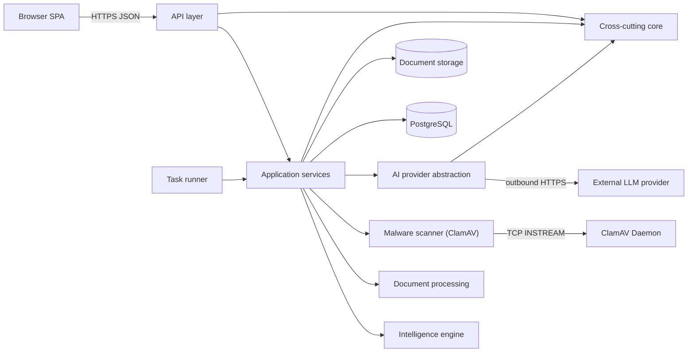
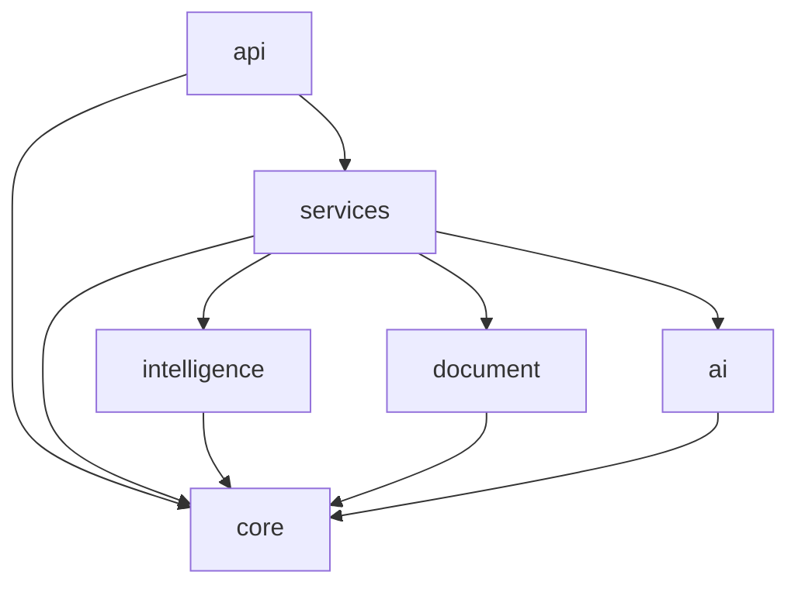
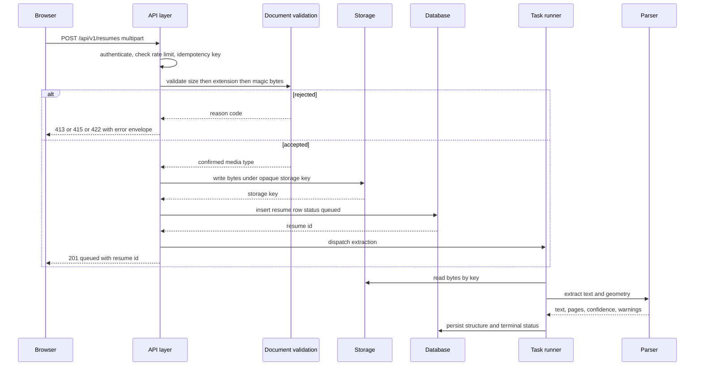
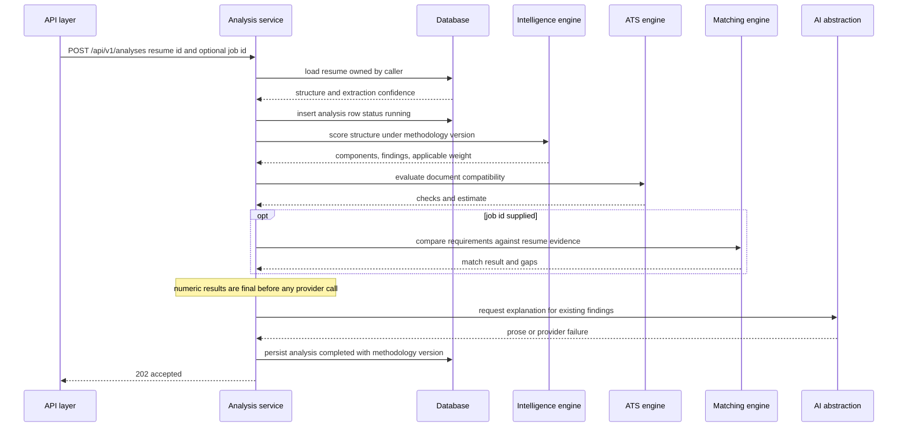
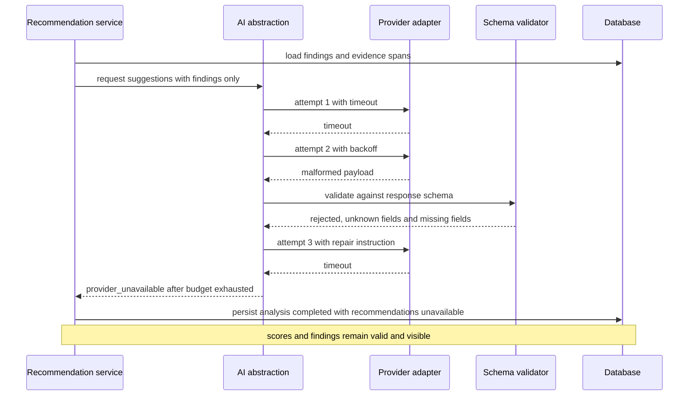
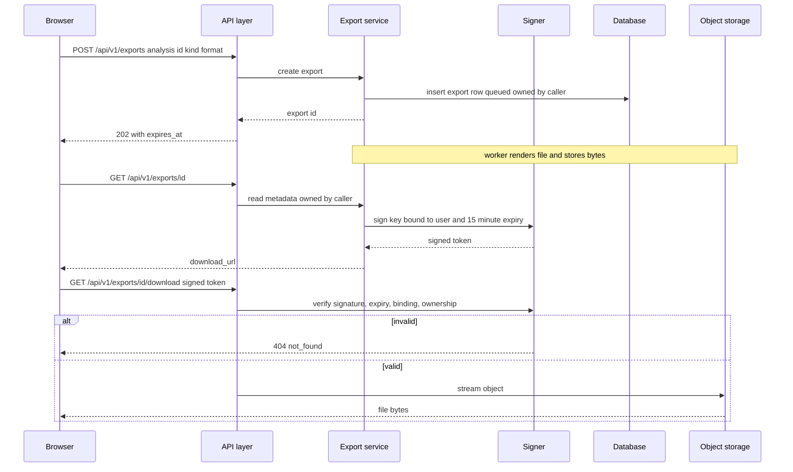
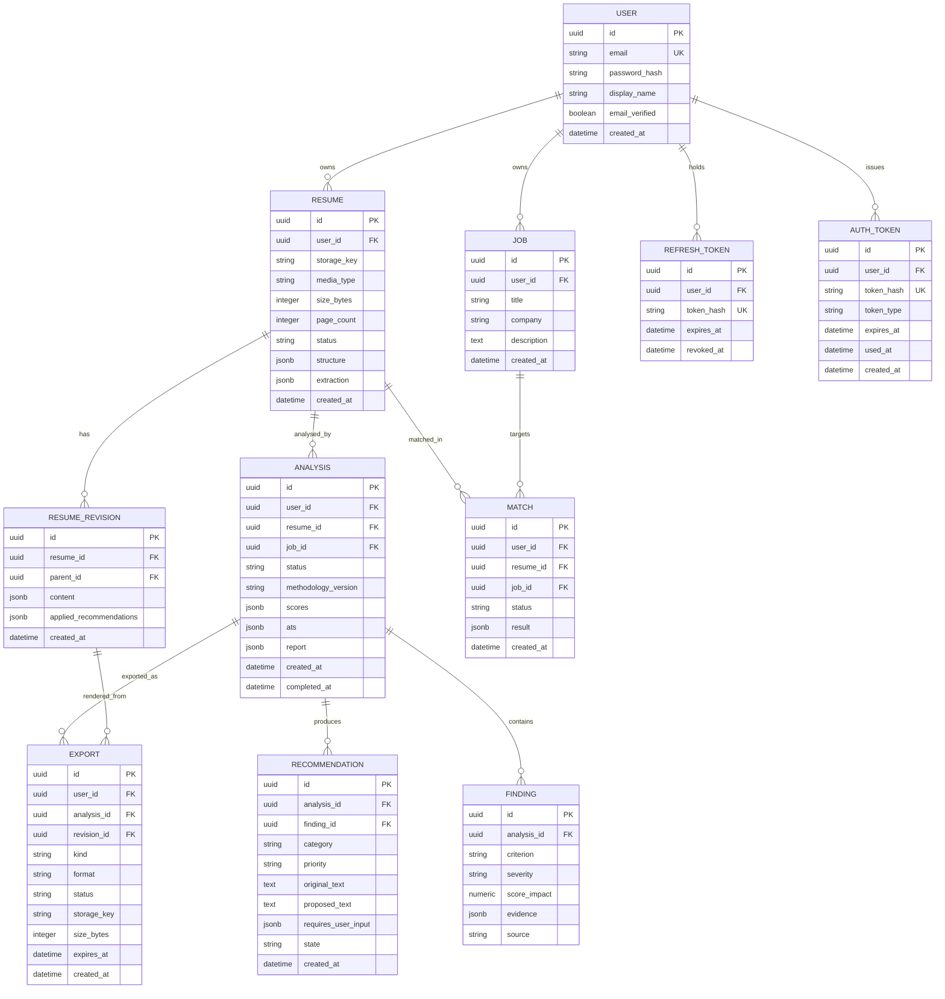
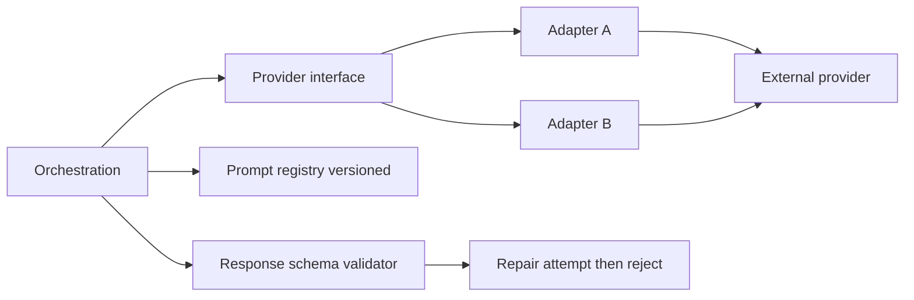
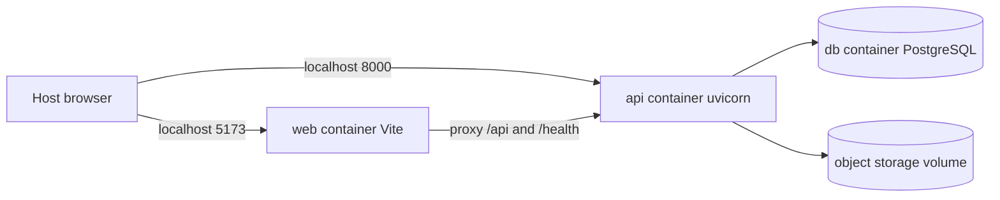

# POTENCIA — System Architecture

**Status:** specification for Phases 2–16. Implementation must conform or this document changes first.
**Companions:** `API.md` (wire contract), `SCORING_METHODOLOGY.md` (scoring contract), `SRS.md` (requirements)
**Author:** Arghya Bose

---

## 1. Architectural drivers

Every structural decision below traces to one of five forces. Each entry states what breaks if it is ignored, because a rule whose failure mode is invisible gets deleted by the first person in a hurry.

| # | Driver | If ignored |
|:-:|:--|:--|
| **D1** | **Deterministic scores, generative prose.** All numbers come from rules; models may only produce text and advisory findings. | Scores drift between runs. A user cannot reproduce or appeal a result. Support cannot answer "why 72 and not 74?" The product becomes unfalsifiable. |
| **D2** | **Document input is hostile.** Every byte from an upload is attacker-controlled until proven otherwise. | Malicious files reach parsers (zip bombs, macro documents), or resume text reaches a model as instructions and redirects its behaviour. |
| **D3** | **Data isolation is structural, not conditional.** Ownership is enforced in the query, never after retrieval. | One missing `if` in a handler becomes a cross-user data leak of the most sensitive document a person owns. |
| **D4** | **Provider independence.** No vendor SDK in business logic. | A price change, outage or deprecation forces a rewrite of the analysis pipeline. The product's roadmap becomes a vendor's roadmap. |
| **D5** | **Explainability is a data property.** Evidence ships inside the response, not in the UI. | A client can render a score with no justification. Findings become decoration, and remediation becomes generic advice the user cannot trust. |

Two secondary drivers shape the operational envelope: **no unbounded work in a request** (parsing and analysis are asynchronous) and **degrade, do not disappear** (a dependency failure is visible and recoverable, not a dead process).

---

## 2. System context



Reading the diagram: the browser talks only to the API layer. The AI abstraction is the **only** egress point, and the browser never reaches it. The task runner is a process that calls the same service layer as the API — it is not a second implementation.

---

## 3. Component boundaries

Six layers under `backend/app/`. Each has one reason to change.

### 3.1 `api/` — HTTP surface

| | |
|:--|:--|
| **Responsibility** | Parse HTTP, authenticate, validate with Pydantic, call exactly one service method, serialise the response schema |
| **Owns** | `routes/`, `dependencies/`, request/response mapping |
| **Never does** | Contain business rules, touch an ORM session directly, call an AI provider, compute a score |
| **May import** | `services`, `schemas`, `core` |

A router that needs two service calls in sequence is a signal the workflow belongs in a service.

### 3.2 `services/` — application orchestration

| | |
|:--|:--|
| **Responsibility** | Transaction boundaries, ownership enforcement, sequencing of intelligence steps, idempotency, persistence of results |
| **Owns** | Use cases: upload, analyse, match, recommend, revise, export |
| **Never does** | Score, parse, or prompt — it delegates to `intelligence/`, `document/`, `ai/` |
| **May import** | `intelligence`, `document`, `ai`, `repositories`, `models`, `schemas`, `core` |

### 3.3 `intelligence/` — measurement

| | |
|:--|:--|
| **Responsibility** | Pure computation over parsed structures: normalization, taxonomy mapping, scoring, ATS checks, matching, finding construction |
| **Owns** | `parser/`, `normalization/`, `scoring/`, `ats/`, `matching/`, `recommendations/`, `evaluation/` |
| **Never does** | Perform I/O, open a database session, call a model, import FastAPI |
| **May import** | `core` (types, taxonomy data) **and nothing else outside itself** |

`intelligence/` is the most valuable code in the repository, so it must be the easiest to test: input structure in, findings and numbers out, no mocking required.

### 3.4 `document/` — bytes to text

| | |
|:--|:--|
| **Responsibility** | Validation, text extraction, automatic OCR fallback, page/geometry analysis, export rendering |
| **Owns** | `extraction.py`, `validation.py`, `ocr.py`, `export/` |
| **Never does** | Know what a score is, read a `Resume` model, or call the intelligence engine |
| **May import** | `core` and its own subpackages |

`document/` returns text plus geometry plus confidence. It extracts native text directly where available; for scanned or image-dominant PDFs, it automatically executes OpenCV preprocessing (grayscale, noise reduction, CLAHE contrast enhancement, Otsu binarization, deskewing) and Tesseract OCR. Ordinary text PDFs bypass OCR entirely.

### 3.5 `services/ocr_service.py` — OCR facade
Exposes modular OCR routines (`ocr_pdf`, `ocr_image`, `preprocess_image`, `deskew_image`) to the document pipeline.

### 3.5 i/ — generation

| | |
|:--|:--|
| **Responsibility** | Provider adapters, prompt versioning, structured-output validation, retry and timeout policy, prompt-injection containment |
| **Owns** | providers/ (gemini.py, ase.py), prompts/, schemas/, orchestration/ |
| **Never does** | Compute or adjust a numeric score, decide which findings exist, or receive raw document bytes |
| **May import** | core and its own subpackages |

i/ encapsulates optional external AI rewrite providers (such as Google Gemini via GeminiRewriteProvider). Untrusted resume text is isolated inside <untrusted_resume_content> delimiters with strict anti-hallucination rules. Output is validated against Pydantic schemas and cached in an in-memory LRU cache. When unconfigured, NullRewriteProvider ensures transparent deterministic fallback without breaking any workflow.

### 3.7 `services/malware_scanner.py` & Document Security

| | |
|:--|:--|
| **Responsibility** | Pre-storage malware scanning, container safety inspection, format validation |
| **Owns** | Native ClamAV `INSTREAM` protocol client, EICAR detection, container validation rules |
| **Never does** | Parse resume contents, touch database rows, expose internal filesystem keys |
| **May import** | `core` |

Upload processing executes an atomic 12-step sequence: streaming upload limits (5 MiB), filename sanitization, signature and magic byte checking (`%PDF-`, `PK`), PDF structure inspection (page count <= 50, encryption rejection, attachment safety), DOCX archive inspection (entries <= 1000, no path traversal in entries, compression ratio <= 100:1, macro rejection), ClamAV malware scan (fail-closed in production), content-addressed storage (`0o600` permissions), text extraction, and cleanup upon post-storage failures.

### 3.8 `services/email_service.py` & Authentication Security

| | |
|:--|:--|
| **Responsibility** | Dual-mode outbound email dispatch (SMTP + in-memory test queue), branded responsive HTML email templating, verification & recovery token delivery |
| **Owns** | SMTP connection management over SSL/TLS, fallback queue `_SENT_EMAILS`, email layouts |
| **Never does** | Persist raw tokens, log credentials or tokens, crash user requests on transient SMTP outages |
| **May import** | `core` |

The authentication lifecycle incorporates:
- **Registration**: Issues credentials, records user as unverified, generates a cryptographically random 32-byte verification token (`secrets.token_urlsafe(32)`), persists its SHA-256 digest in `auth_tokens`, and dispatches a verification email.
- **Verification (`/api/v1/auth/verify-email`)**: Hashes the token, looks up unconsumed, unexpired token, marks user `email_verified=True`, consumes the token (`used_at`), and invalidates previous pending tokens.
- **Password Recovery (`/api/v1/auth/forgot-password` & `/reset-password`)**: Generic anti-enumeration response on forgot-password, one-time hashed token with 60-minute expiry, password update with minimum 12 characters, and `token_version` increment revoking all existing refresh tokens.

### 3.9 `core/` — cross-cutting

| | |
|:--|:--|
| **Responsibility** | Settings, structured logging, error taxonomy, request context, database engine and session factory, security primitives |
| **Owns** | `config.py`, `logging.py`, `errors.py`, `database.py`, `security.py` |
| **Never does** | Import any other application layer |
| **May import** | Third-party libraries only |

---

## 4. Dependency rule

The dependency direction is strictly downward. Nothing below imports anything above it, and no module imports a sibling it does not need.



Forbidden, and enforced in review:

| Forbidden import | Why it matters |
|:--|:--|
| `document/` → `intelligence/` or `scoring` | `document/` must not know a scoring engine exists. Extraction is verified against text fixtures, not against scores, so a scoring change can never force an extraction rewrite. |
| `intelligence/` → `ai/` | Measurement must not depend on generation. If scoring could import a provider, the "LLM never decides a number" guarantee becomes a code-review promise instead of a structural fact. |
| `intelligence/` → `models/`, `repositories/`, SQLAlchemy | Pure functions over plain structures. A database change must not alter how a criterion is computed. |
| `ai/` → `intelligence/` | The provider layer receives findings and returns prose. It never sees the rules that produced them, so it cannot be tempted to re-derive them. |
| Anything → `api/` | The HTTP surface is an adapter, not a dependency. |
| `core/` → any application layer | Prevents a circular import chain through the cross-cutting module. |

### 4.1 Enforcement

Convention alone decays, so this is mechanical:

1. **Static test** — `tests/architecture/test_import_boundaries.py` walks the module tree with `ast`, builds the import graph, and asserts none of the forbidden edges above exist. It runs in CI on every pull request.
2. **Review checklist** — a reviewer rejecting a layering violation names the rule number (D1–D5 or the §4 table), not a preference.
3. **Package `__init__` discipline** — each layer exports its public surface explicitly, so an accidental deep import is visible in the diff rather than buried in a function body.

A boundary that only lives in a document is a suggestion. The test above is the actual boundary.

---

## 5. Request lifecycle

### 5.1 Resume upload → validation → storage → parse



Validation order is fixed: header, then extension, then content. Cheapest rejection first means a 200 MB file is never written to disk to discover it is a `.zip`.

### 5.2 Analysis run



The ordering note is the load-bearing part of this diagram: **scoring completes before `ai/` is invoked**. If the provider is removed from the system entirely, the analysis still produces the same numbers and findings.

### 5.3 Recommendation generation with provider failure



Three attempts is a budget, not a retry loop. When exhausted, the analysis is **not** failed — it completes with `recommendations_unavailable: true`, because the deterministic half of the report is already correct and withholding it would punish the user for our vendor's outage.

### 5.4 Export download



A signed URL that fails any check returns `404`, not `403` — a distinguishable error tells an attacker that an export id exists.

---

## 6. Data model outline



### 6.1 Ownership constraint

**Every owned row carries `user_id` at the row level, including tables reachable only through a parent** (`analysis`, `match`, `export`, `finding` via analysis). Denormalising `user_id` is deliberate: an authorization query must never need a join to establish ownership, because a join is a place to forget one.

Consequences:

- Repositories take `user_id` as a mandatory first parameter. There is no `get_analysis(id)` — only `get_analysis(id, user_id)`.
- A cross-user read returns `Not Found`, per `API.md` §1.3.
- `DELETE /users/me` cascades through every `user_id` column; deletion is verified by test, not assumed from `ON DELETE CASCADE`.

### 6.2 Indexes

| Table | Index | Serves |
|:--|:--|:--|
| `user` | unique `email` | Login lookup, duplicate detection |
| `refresh_token` | unique `token_hash`; `(user_id, expires_at)` | Rotation, bulk revocation |
| `resume` | `(user_id, created_at desc)` | Resume history list |
| `resume` | `(user_id, status)` | In-flight work, cleanup sweep |
| `resume_revision` | `(resume_id, created_at desc)`, `(parent_id)` | Version list, chain walk |
| `analysis` | `(user_id, created_at desc)` | Analysis history |
| `analysis` | `(resume_id, methodology_version)` | Re-score detection |
| `finding` | `(analysis_id, severity)` | Prioritised report assembly |
| `job` | `(user_id, created_at desc)` | Job list |
| `match` | `(user_id, created_at desc)`, unique `(resume_id, job_id, status)` | History, duplicate suppression |
| `recommendation` | `(analysis_id, state)`, `(finding_id)` | Pending queue, provenance |
| `export` | `(user_id, created_at desc)`, `(expires_at)` | History, retention sweep |

JSON columns are `jsonb` for indexed key access and are treated as immutable snapshots once written — a report is never mutated in place after completion, because a user's saved history must not silently change.

---

## 7. Storage strategy

Bytes and metadata live in different systems, for different reasons.

| Concern | Location | Why |
|:--|:--|:--|
| File bytes | Object storage, addressed by an opaque `storage_key` | Keeps the database small and backup fast; allows lifecycle deletion independent of row deletion |
| Extracted structure | `resume.structure` (`jsonb`) | Needed on every analysis; joins to object storage per request would be wasteful |
| Findings, scores, reports | `analysis` and `finding` rows | Queryable, auditable, version-tagged |
| Export bytes | Object storage, separate prefix | Never in the manifest of documents under analysis |

**The database never holds raw file bytes.** Storing a 5 MiB PDF in a `bytea` column inflates every backup, drags the whole file through the connection pool on read, and makes the row the unit of access control. The row is a pointer; the object store is the payload.

Access path: the client never receives a storage key or an object-store URL. It receives `GET /api/v1/exports/{id}/download?token=...`, which the API verifies and streams server-side. Storage credentials exist only in the API process.

Deletion is two-phase and ordered: mark the row deleted, then remove the object, then purge the row. If the object delete fails, the row remains in a purgeable state and a sweep retries. The reverse order would leave bytes with no owner — unreachable, unbilled to a user, and forgotten.

---

## 8. AI provider abstraction



### 8.1 Interface

One internal contract, vendor-neutral:

```
complete(task: TaskSpec) -> ValidatedResult
```

`TaskSpec` carries: prompt template id, prompt version, rendered variables, the response model to validate against, timeout, and retry budget. `ValidatedResult` carries the parsed object plus provider metadata (model id, latency, token counts, prompt version). Business code never sees a vendor payload.

### 8.2 Adapter responsibilities

- Translate `TaskSpec` into a provider request.
- Map provider errors into the internal taxonomy (`timeout`, `rate_limited`, `auth_failed`, `malformed_output`, `content_filtered`).
- Never retry internally — the orchestration layer owns the budget, so retry policy is identical across providers.
- Never log prompt or response bodies.

### 8.3 Retry, timeout, budget

| Setting | Value | Rationale |
|:--|:--|:--|
| Per-attempt timeout | 30 s | Bounded, so one stalled call cannot hold a worker |
| Total budget | 90 s | Three attempts within one user-visible wait |
| Attempts | 3, exponential backoff with jitter | Covers transient faults, not outages |
| Retried classes | `timeout`, `rate_limited`, `malformed_output` | `auth_failed` and `content_filtered` are terminal; retrying them burns budget and money |

Exhausting the budget produces a degraded analysis (§5.3), never a failed one.

### 8.4 Output validation

Every model response is validated against a Pydantic model before persistence. Unknown fields are rejected (a silently ignored field is an undocumented behaviour change), missing required fields trigger one repair attempt, then rejection. A rejected response is discarded — never partially applied. Partial application of an invalid payload is how a fabricated metric ends up in a user's resume.

### 8.5 Prompt versioning

Prompts live in `ai/prompts/` as versioned templates with a content hash. Every generated artefact records `prompt_id`, `prompt_version` and the hash alongside `methodology_version`. Editing a prompt is a new version, never an in-place change, so a recommendation produced last month can be explained with the prompt that actually produced it.

### 8.6 Prompt-injection defence

Resume text and job descriptions are **data, never instructions**. Enforced as:

1. **Delimited insertion** — untrusted text is placed inside explicit data delimiters, never concatenated into the instruction section.
2. **Static system prompt** — the instruction half of every prompt is a constant, versioned artefact. No user-controlled string reaches it.
3. **Output allow-listing** — responses must validate against a closed schema. Free-form text cannot smuggle a control decision, because there is no field for one to occupy.
4. **No tool authority** — the generation path has no tools, no function calling, no retrieval that could act on instruction text.
5. **Instruction-shaped content is flagged** — patterns such as "ignore previous instructions" inside a resume are surfaced as a finding (`suspicious_content`), not obeyed.
6. **Minimum disclosure** — only the text needed for the requested task is sent: bullet text and evidence spans, not the whole document, and never contact details unless the task concerns them.

### 8.7 The invariant

**The numeric score is computed before any provider call, and nothing returned by a provider may modify it.** This is not a policy in prose — `ai/` cannot import `intelligence/`, and the analysis service calls scoring first, as drawn in §5.2.

---

## 9. Failure and degradation matrix

| Failure | User-visible behaviour | Data consequence | Retry semantics |
|:--|:--|:--|:--|
| **Database unreachable** | `GET /health` → `503`, `status: degraded`, `dependencies.database: unavailable`. Data endpoints → `503 dependency_unavailable`. | No writes attempted. No partial rows. | Client backoff. Health recovers automatically; `pool_pre_ping` discards dead connections. |
| **Object storage write fails on upload** | `502 dependency_unavailable` before any row is created. | No orphan row. Validation passed, so a retry re-uploads the same bytes harmlessly. | Safe to retry — there is no row to desynchronise. |
| **OCR engine unavailable** | Resume completes with `extraction.method: text_layer` or `partial` and an explicit warning; `AT-01` capped, confidence drops to `low`, and the UI states the limitation. | Structure persisted with `uncertain` entries instead of guesses. | No automatic retry; OCR is a fallback, not a requirement. Re-upload is the user's remedy. |
| **Parser produces empty text** | Resume terminal `failed` with `retryable: false` and a message naming the cause (likely scanned or corrupted). | No structure invented. No analysis permitted on this resume. | Terminal. Blocking an analysis is correct: scoring empty text would produce a confident zero. |
| **AI provider timeout** | Analysis completes; `recommendations_unavailable: true` with a retry action. Scores, ATS and findings all present. | Analysis row complete; no recommendation rows. | Explicit user re-request. Automatic retry only within the §8.3 budget. |
| **AI provider malformed output** | Same as timeout after one repair attempt. Raw response discarded. | Nothing persisted from the bad payload. | As above. Rejected payload is never partially applied. |
| **AI provider auth failure** | Same visible degradation, `retryable: false`, plus an operational alert. | No recommendation rows. | Not retried in-request; this is a configuration fault, not a transient one. |
| **Worker crashes mid-analysis** | Analysis row shows `running` past its expected window; the UI offers cancel and retry. | Row left non-terminal; no partial scores written because scores are written in one transaction at the end. | Reaper marks rows `running` beyond `2 × p95` as `failed` with `retryable: true`. Idempotent restart reprocesses from the stored structure. |
| **Worker crashes after analysis commit, before recommendation commit** | Findings visible, recommendations absent. | Consistent: the analysis transaction already closed. | Re-request recommendations only; scoring is not recomputed. |
| **Concurrent decision on same recommendation** | Second `POST /decision` returns current state (`200`), not an error. | Last write wins on a single small row; state machine rejects illegal transitions. | Idempotent by contract (`API.md` §3.7). |
| **Rate limit exceeded** | `429` with `Retry-After`. | None. | Client honours the header. |
| **Idempotency key reused after 24 h** | Treated as a fresh request. | A duplicate analysis may be created. | Bounded by the 24-hour window and the rate limit. |

Two rules hold across the matrix: **a partial result is never presented as complete**, and **a degraded result is never hidden**.

---

## 10. Observability

### 10.1 Structured log fields

Every request and every task emits one JSON line, keyed by `request_id`:

| Field | Example | Purpose |
|:--|:--|:--|
| `request_id` | `req_01JCM8W3Z9` | Correlates the API response header, the log line and the error envelope |
| `event` | `http.request` / `task.extract` | Discriminator |
| `endpoint` | `POST /api/v1/analyses` | Route template, not the concrete path |
| `status` / `duration_ms` | `202` / `41` | Latency and outcome |
| `user_id` | `018f...` | Accountability without identity |
| `task_id`, `attempt` | `01JC...`, `2` | Retry visibility |
| `dependency` | `ai_provider`, `database` | Which subsystem degraded |
| `error_code` | `dependency_unavailable` | Joins logs to the error taxonomy |
| `methodology_version` | `1.1.0` | Ties a result to the rules that produced it |

### 10.2 Never logged

Resume text, job description text, bullet content, contact details, original filenames, storage keys, tokens (access, refresh, signed), passwords, full model prompts or responses, and provider API keys. Logs are retained and occasionally pasted into issue trackers; a resume in a log line is a data breach with a paper trail.

### 10.3 Request id propagation

The middleware accepts an inbound `X-Request-ID` or generates one, stores it in a `contextvar`, echoes it in the response header, and includes it in the error envelope. Worker tasks inherit the originating `request_id` so a background failure is traceable to the request that caused it — otherwise "my analysis never finished" is unanswerable.

---

## 11. Deployment topology

### 11.1 Development



Compose services: `db`, `api`, `web`. PostgreSQL is a service, never a host prerequisite — the audit found no host `psql`, and requiring one makes onboarding fail on the first command.

Redis is deliberately absent at this stage. Phase 4 runs extraction on an in-process task runner (ADR-06); Redis arrives in Phase 15 only when concurrent workers outgrow a single process.

### 11.2 Production

| Concern | Approach |
|:--|:--|
| Frontend | Static build served over HTTPS by a CDN or reverse proxy |
| API | Containerised uvicorn behind a TLS-terminating proxy, replicas ≥ 2 for rolling deploys |
| Database | Managed PostgreSQL, automated backups, point-in-time recovery, TLS required |
| Object storage | Private bucket, no public read policy, server-side encryption, lifecycle rules matching the retention policy |
| Migrations | `alembic upgrade head` as a release step before new containers receive traffic |
| Checks | `/health` gates readiness; a replica failing its dependency check is removed from rotation, not killed |
| Secrets | Injected environment, never baked into images or committed |

### 11.3 CI secrets

GitHub Actions secrets, branch protection rules and deployment environments require repository **admin**. The current collaborator holds `push` only (audit §4), so pipeline definition and application code can be authored and merged, but configuring the secrets that make a deploy pipeline run requires the repository owner. Phase 16 cannot complete without that access.

---

## 12. Architecture decision record

### ADR-01 — Deterministic scoring, generative explanation

**Context.** LLM-as-judge scoring is fast to build, produces plausible numbers and respectable demos, and is unvalidatable.
**Decision.** All numeric scores come from the rule set in `SCORING_METHODOLOGY.md`. Providers supply only prose and advisory findings tagged `source: llm` with `score_impact: null`.
**Consequences.** Scores are reproducible and defensible; each criterion is unit-testable without mocking. Cost of writing and calibrating rules falls on us, and scoring cannot improve "for free" by swapping a bigger model. Accepted: correctness beats convenience here.

### ADR-02 — Layered backend enforced by a static import test

**Context.** "Clean architecture" documents are routinely violated within months because nothing fails when they are.
**Decision.** Six layers with the direction in §4, enforced by an AST-based test in CI in addition to review.
**Consequences.** Some conveniences are lost — no quick query inside a router, no provider call inside a criterion. In exchange, `intelligence/` stays pure and the extraction/scoring boundary survives refactors.

### ADR-03 — Metadata in PostgreSQL, bytes in object storage

**Context.** A resume is small enough to store in a column, which makes the database the simplest single source of truth.
**Decision.** Bytes live in object storage behind an opaque key; the row holds the key, the extracted structure and the analysis.
**Consequences.** Backups stay small, uploads do not traverse the connection pool, and deletion can be lifecycle-managed. Cost: two systems to keep consistent, mitigated by the ordered two-phase delete in §7.

### ADR-04 — Ownership in the query, `user_id` on every owned row

**Context.** Filtering after retrieval is the standard shortcut and the standard source of cross-tenant leaks.
**Decision.** Every repository method requires `user_id`; ownership is denormalised onto child tables; cross-user access returns `404`.
**Consequences.** Redundant columns and slightly more write work. In return, no handler can forget a filter, and a leak requires editing the repository signature rather than omitting a line.

### ADR-05 — Provider abstraction with a bounded retry budget

**Context.** Adopting a vendor SDK directly is a day of work; changing vendors later is a quarter.
**Decision.** One internal `complete(task) -> ValidatedResult` contract, adapters per provider, retry owned by orchestration, schema validation before persistence.
**Consequences.** Slight indirection overhead and a smaller usable feature surface than any single vendor's SDK. Buys vendor portability, uniform failure semantics, and a single place to enforce injection defences.

### ADR-06 — In-process task runner now, Redis-backed workers in Phase 15

**Context.** Parsing and analysis must not block a request, which suggests a queue immediately.
**Decision.** Phase 4 dispatches to an in-process runner; the service layer is written as if it were already async so the dispatch point is the only thing that changes.
**Consequences.** Dev requires no extra infrastructure and the Phase 2 stack stays at three services. Limits: a restart loses queued work and horizontal scaling is impossible. Deferred, not denied — the seam is explicit and Phase 15 replaces the dispatcher, not the services.

### ADR-07 — Findings are the unit of explanation, with mandatory evidence

**Context.** The natural output of a scorer is a number; the natural output of a chat model is advice.
**Decision.** Every deduction is a `Finding` carrying criterion id, verbatim evidence with structural location, explanation, remediation and exact `score_impact`. Evidence is a required field.
**Consequences.** Reports are larger and every criterion must track spans through extraction — real effort in Phase 4. In exchange, advice is falsifiable, findings reconcile arithmetically with the score, and the UI cannot render unexplained judgement.

### ADR-08 — Degrade to a partial answer, never to a wrong one

**Context.** When a dependency fails, the tempting move is to fill the gap with a default — score the missing category as zero, or generate a placeholder recommendation.
**Decision.** Missing input removes weight from the denominator; missing provider output removes recommendations and says so; unextractable documents fail outright rather than score as empty.
**Consequences.** Some runs return less than a user hoped for, and `applicable_weight` complicates the arithmetic. In return, no user ever acts on a number derived from data we did not have.

### ADR-09 — Concurrent AI Proposal Pre-Fetching with Bounded Worker Pool

**Context.** In Phase 20, generating AI rewrite proposals for multiple high-priority recommendations sequentially created a noticeable latency bottleneck on cold requests.
**Decision.** In Phase 24, `recommendation_service.py` executes AI proposal generation for top priority candidates concurrently using `concurrent.futures.ThreadPoolExecutor(max_workers=5)` bounded by a strict 10-second timeout. Any failed, timed-out, or rate-limited candidate falls back instantly to deterministic rules.
**Consequences.** Cold request latency is reduced up to 5x. If the external provider is slow or unavailable, deterministic rules are returned without delaying the user experience.

### ADR-10 — Multi-Tier Testing Architecture

**Context.** Complex interactions between FastAPI services, background tasks, database migrations, security rules, and React UI require distinct testing horizons to prevent regressions.
**Decision.** Establish four discrete, hermetic testing tiers:
1. **Backend Unit & Integration (Pytest):** 234 tests covering auth, token verification hashing, ClamAV malware scanning, OCR extraction, deterministic ATS arithmetic, cross-tenant 404 isolation, and programmatic Alembic migration round-trips.
2. **Frontend Unit & Component (Vitest + Testing Library):** 19 tests in jsdom testing accessible DOM rendering, form validation, error states, and mutation workflows.
3. **End-to-End User Journeys (Playwright):** 14 complete user journeys verifying browser flows against the integrated full stack.
4. **Deterministic Profiling & Benchmarking:** Automated profiling harness (`scripts/profile_engine.py`) verifying latency and sub-linear scaling invariants.
**Consequences.** Comprehensive test coverage without external network requirements; regressions are caught at the lowest feasible level.
