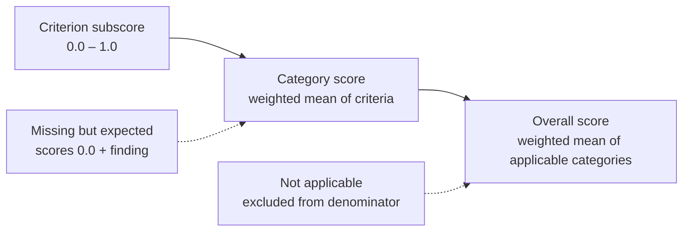

# POTENCIA — Scoring Methodology

**Methodology version:** `1.0.0`
**Status:** specification. Implemented in Phase 6; calibrated in Phase 14.
**Owner:** scoring engine (`backend/app/intelligence/scoring/`)

This document is normative. The scoring engine is correct if, and only if, it produces exactly the numbers this document specifies for given input. Where the implementation and this document disagree, this document is the defect report.

---

## 1. Design position

Most resume tools ask a language model "rate this resume out of 100". That produces three failures we refuse to ship:

1. **Variance** — the same resume scores differently on the next call.
2. **Opacity** — no user can tell which sentence cost them a point.
3. **Manipulability** — a resume written to flatter the grader scores well while remaining a bad resume.

POTENCIA inverts the relationship. **Numbers come from rules. Prose comes from models.** Concretely:

| Layer | May produce scores | May produce text | May produce findings |
|:--|:-:|:-:|:-:|
| Deterministic rules (this document) | ✅ | ✅ | ✅ |
| NLP similarity / taxonomy | ❌ | ❌ | ✅ advisory |
| LLM | ❌ **never** | ✅ | ✅ advisory, explicitly tagged |

An LLM-generated finding carries `source: "llm"` and `score_impact: null`. It can never move a number. If a model output is the only available signal for a criterion, that criterion's weight is **removed from the denominator** — the honest response to "we cannot measure this" is a smaller denominator, not a guessed contribution.

---

## 2. Score composition



| Category | Weight | Rationale |
|:--|--:|:--|
| `content_quality` | 25 | What the resume says. The dominant driver of whether a human reads on. |
| `experience` | 20 | Whether the work history reads as credible and consequential. |
| `skills` | 15 | Whether capability is legible and organised. |
| `structure` | 15 | Whether a reader — human or machine — can navigate it. |
| `ats_compatibility` | 15 | Whether it survives extraction at all. |
| `language_readability` | 10 | Whether it is clean enough to read without friction. |
| **Total** | **100** | |

> These weights are **product-design hypotheses**, not empirical industry standards. §9 defines what must happen before they can be presented as otherwise.

### 2.1 Arithmetic

For each category `c` with applicable criteria `i`, each scoring `s_i ∈ [0,1]` and weight `w_i`:

```
category(c) = Σ(w_i × s_i) / Σ(w_i)      over applicable criteria only
```

Overall, over applicable categories `c`:

```
overall = 100 × Σ(W_c × category(c)) / Σ(W_c)
applicable_weight = Σ(W_c)
```

Rules that make this reproducible:

- Floating point is computed in `Decimal` at 4 decimal places; the API rounds to **one** decimal place exactly once, at serialisation.
- No randomness or sampling. Date-relative criteria (SK-05 recency and ST-04 length versus career span) use the UTC calendar year at analysis time; the same input and year yield the same score, while an explicit later re-analysis can differ when that reference year changes. The original stored analysis is not silently recalculated.
- Ordering of criteria never affects the result.
- `applicable_weight` is always reported. A score of 82 over `applicable_weight: 60` means something structurally different from 82 over 100, and hiding that would be misleading.

---

## 3. Not applicable vs. missing

This is the single most important rule for fairness, and the most common place resume scorers produce nonsense — punishing a student for having no employment history, or rewarding a missing Skills section as if its absence were neutral.

| State | Meaning | Effect | Example |
|:--|:--|:--|:--|
| **Applicable** | The material exists and can be judged | Scored normally | Experience section with 3 roles |
| **Not applicable** | The criterion genuinely does not apply to this candidate | **Excluded** from both numerator and denominator; no finding | `job_match` with no job description supplied |
| **Missing** | Expected for this profile, and absent | **Scores 0.0**, raises a `high` severity finding | Experienced engineer with no Skills section |

### 3.1 Classification rule (deterministic)

Classification uses only facts extracted from the resume, never inference about the candidate's life:

```
expected_section(kind) := (
    kind == experience  and  (any of: internships, projects, or explicit work history detected)
) or (
    kind == experience  and  document contains an experience-like heading
) or (
    kind != experience  and  document contains the corresponding heading
)
```

Then:

- Heading present, content extractable → **applicable**
- Heading present, content empty or unextractable → **missing** (and an extraction finding is raised)
- No heading, `expected_section == true` → **missing**
- No heading, `expected_section == false` → **not applicable**

A resume for a first-time candidate with no internship, no project and no experience heading yields `experience: not applicable`. The experience weight (20) leaves the denominator, `applicable_weight` becomes 80, and the overall score is computed on what the candidate actually presented. The user is told this plainly: *"Experience was not scored because no work history was found. If you have internships or projects, add them."*

This is the opposite of generosity — every remaining category carries more weight, so weaknesses elsewhere bite harder. It is simply accurate.

---

## 4. Criteria catalogue

`weight` is within-category. `property` labels which underlying defect the criterion **owns**, for double-penalty prevention (§6).

### 4.1 Content Quality — weight 25

| ID | Criterion | Wt | Property | Measurement | Subscore | Evidence |
|:--|:--|--:|:--|:--|:--|:--|
| CQ-01 | Professional summary | 15 | `summary` | Summary exists, 20–80 words, contains role + domain + differentiator; no first-person pronouns | `1.0` all met · `0.7` exists, 1 miss · `0.4` exists, 2+ misses · `0.0` absent | Summary text span |
| CQ-02 | Bullet structure | 25 | `bullet_structure` | Fraction of experience/project bullets matching `[strong verb] + [object] (+ [outcome])` | `clamp(ratio / 0.8, 0, 1)` | Failing bullet spans |
| CQ-03 | Quantification density | 25 | `quantification` | Fraction of bullets containing a number, percentage, currency, duration or explicit scale | `clamp(ratio / 0.5, 0, 1)` — 50 % quantified is full credit | Unquantified bullet spans |
| CQ-04 | Action-verb variety | 15 | `verb_lexicon` | Distinct lead verbs ÷ bullets (cap 1.0), with a penalty when any verb appears in the weak set (`worked on`, `helped`, `responsible for`, `assisted with`, `involved in`) | `variety × (1 − 0.1 × min(weak_count, 5))` | Weak verb spans |
| CQ-05 | Specificity | 20 | `specificity` | Count of generic phrases from the versioned clause library (`team player`, `hard working`, `various tasks`, `etc.`) | `1.0 − 0.1 × min(hits, 10)` | Each matched phrase |

Rationale for the `0.5` target on CQ-03: requiring every bullet to be quantified is wrong — plenty of work is genuinely unquantifiable. Half is where a resume starts to read as evidenced rather than described.

### 4.2 Experience — weight 20

| ID | Criterion | Wt | Property | Measurement | Subscore |
|:--|:--|--:|:--|:--|:--|
| EX-01 | Role clarity | 20 | `role_clarity` | Each entry has title, organisation and dates | `1.0` all complete · `0.0` any entry missing title or organisation |
| EX-02 | Chronology integrity | 25 | `chronology` | Order is reverse-chronological; no end before start; gaps > 6 months between roles are either explained or surfaced | `1.0` clean · `−0.25` per inversion, invalid range, or unexplained gap (floor `0.0`) |
| EX-03 | Achievement orientation | 30 | `achievement_framing` | Fraction of bullets asserting an outcome or result rather than a duty | `clamp(ratio / 0.6, 0, 1)` |
| EX-04 | Progression and tenure | 15 | `progression` | Title seniority trend across roles; median tenure | `1.0` rising titles and median ≥ 12 months · `0.6` flat · `0.3` falling or median < 6 months |
| EX-05 | Relevance density | 10 | `experience_relevance` | Fraction of explicitly claimed canonical skills with a whole-mention in role titles, employers or bullets | `clamp(ratio / 0.5, 0, 1)` |

EX-04 is deliberately gentle: a candidate who changed roles recently is not a bad candidate. Its weight (15 within category → 3 overall) matches its actual signal value.

### 4.3 Skills — weight 15

| ID | Criterion | Wt | Property | Measurement | Subscore |
|:--|:--|--:|:--|:--|:--|
| SK-01 | Explicit coverage | 25 | `skill_coverage` | Count of distinct canonical skills in the taxonomy | `clamp(count / 10, 0, 1)` |
| SK-02 | Organisation | 20 | `skill_grouping` | Skills grouped into ≥ 2 meaningful clusters (languages, frameworks, tools, domains) | `1.0` grouped · `0.5` flat list · `0.0` skills only inside prose |
| SK-03 | Redundancy | 15 | `skill_redundancy` | Duplicate entries and overlapping aliases (`JS` / `JavaScript`) | `1.0 − 0.15 × duplicates` (floor `0.0`) |
| SK-04 | Verifiability | 25 | `skill_verifiability` | Fraction of claimed skills with a whole-mention outside the summary and skills list—in roles, projects (including technology lists), certifications, achievements or leadership | `clamp(ratio / 0.7, 0, 1)` |
| SK-05 | Recency | 15 | `skill_recency` | Fraction of skills appearing in bullets of roles that ended within 5 UTC calendar years (ongoing roles count as current); a malformed explicit end is unknown, not current | `clamp(ratio / 0.6, 0, 1)`, **not applicable** when no dates parse |

SK-04 is the criterion that protects honesty: it rewards a short, defensible skill list over a wall of keywords the resume never substantiates. Mentions use taxonomy aliases and whole-token boundaries; a skill in the summary alone is still a claim, not demonstrated use. It also feeds §5's recommendation rule — a low SK-04 produces "remove or substantiate" advice, never "add more keywords".

### 4.4 Structure — weight 15

| ID | Criterion | Wt | Property | Measurement | Subscore |
|:--|:--|--:|:--|:--|:--|
| ST-01 | Standard sections | 30 | `section_presence` | Of contact, summary, experience, education, skills — how many are present and applicable | `present / applicable_expected` |
| ST-02 | Section ordering | 15 | `section_order` | Contact first; summary before experience; education position appropriate to seniority | `1.0` correct · `0.5` one inversion · `0.0` more |
| ST-03 | Heading clarity | 20 | `heading_clarity` | Headings map to a canonical section, not creative labels (`My Journey`, `Where I've Been`) | `canonical / total` |
| ST-04 | Length discipline | 15 | `length` | Pages vs. seniority: ≤ 1 page under 8 years, ≤ 2 pages otherwise | `1.0` within band · `0.5` one page over · `0.0` further over |
| ST-05 | Contact completeness | 20 | `contact` | Email present and parseable, phone or profile link present, no full postal address | `1.0` complete · `0.5` partial · `0.0` email missing |

### 4.5 ATS Compatibility — weight 15

| ID | Criterion | Wt | Property | Measurement | Subscore |
|:--|:--|--:|:--|:--|:--|
| AT-01 | Extraction fidelity | 30 | `extraction` | Chars extracted ÷ expected chars for page count; text-layer vs OCR | `extraction.confidence` directly (0–1) |
| AT-02 | Reading order | 20 | `reading_order` | Column detection; whether reflowed order preserves section adjacency | `1.0` single column · `0.5` columns reflow cleanly · `0.2` order corrupted |
| AT-03 | Structural hazards | 15 | `hazards` | Tables, text boxes, images containing text, section headers/footers with contact info | `1.0 − 0.2 × hazards` (floor `0.0`) |
| AT-04 | Date parseability | 20 | `dates` | Dates in a consistent, unambiguous format (`Mar 2024` / `2024-03`), not `03/04` | `1.0` consistent · `0.5` mixed but parseable · `0.0` ambiguous |
| AT-05 | Contact parseability | 15 | `contact_parse` | Email and phone recoverable from extracted plain text, not only from an image | `1.0` both · `0.5` one · `0.0` neither |

AT-01 is deliberately the largest weight in this category: if text does not extract, nothing downstream matters. A scanned, OCR-only document cannot exceed AT-01 = 0.6 by construction, which is the correct ceiling for a file no ATS will read cleanly.

### 4.6 Language & Readability — weight 10

| ID | Criterion | Wt | Property | Measurement | Subscore |
|:--|:--|--:|:--|:--|:--|
| LR-01 | Grammar and spelling | 25 | `grammar` | Language-tool findings per 100 words | `1.0 − 0.05 × max(0, issues_per_100w − 1)` (floor `0.0`) |
| LR-02 | Tense consistency | 20 | `tense` | Present tense for current roles, past for ended roles | `consistent_bullets / bullets` |
| LR-03 | Passive construction | 20 | `passive` | Fraction of bullets in passive voice | `1.0 − clamp(ratio / 0.5, 0, 1)` |
| LR-04 | Sentence length | 15 | `sentence_length` | Mean words per bullet, target band 12–24 | `1.0` in band · linear decay to `0.0` at ±12 words outside |
| LR-05 | First-person and filler | 20 | `pronouns` | Count of `I`, `my`, `me`, `we` and filler openers | `1.0 − 0.1 × min(hits, 10)` |

---

## 5. Evidence and explanation contract

Every criterion emits, for every deduction, a `Finding` conforming to `API.md` §2.6 with:

1. **Criterion ID** — `CQ-03`, `AT-02`, etc.
2. **Evidence** — at least one verbatim span from the resume, with its structural location (`experience[1].bullets[3]`). Verbatim, not paraphrased: a user must be able to find the sentence.
3. **Explanation** — why this reduces effectiveness, in the user's terms.
4. **Remediation** — what to change, phrased so a person who *does not* have the missing information is not pushed to invent it.
5. **`score_impact`** — the exact positive point loss this finding contributes, so the findings sum reconciles with the score. Findings with a score impact are ordered by descending impact (then severity and stable criterion/id tie-breaks); advisory findings with no impact follow. If the sum does not reconcile, the report is unchecked and must not ship.

**Remediation honesty rule.** When a fix requires a fact the resume does not contain, the finding asks for it rather than supplying one:

> ✅ "This bullet has no measurable outcome. What scale did the migration operate at — records, requests per day, or downtime avoided? Add the real figure."
> ❌ "Reduced latency by 40 % and improved throughput by 3×." *(fabricated)*

That second sentence is the single most damaging output this product could produce, because users trust it and paste it into a document they send to employers.

---

## 6. Double-penalty prevention

One underlying defect is owned by exactly one criterion. The `property` column in §4 is the ownership map; the engine asserts uniqueness at import time and raises on a duplicate.

| Defect | Owner | Must be ignored by |
|:--|:--|:--|
| Bullet has no metric | `quantification` (CQ-03) | LR-04, EX-03 |
| Weak verb used | `verb_lexicon` (CQ-04) | `bullet_structure` (CQ-02), LR-03 |
| Bullet is a duty statement | `achievement_framing` (EX-03) | CQ-02 |
| Passive voice | `passive` (LR-03) | CQ-04, EX-03 |
| Non-standard heading | `heading_clarity` (ST-03) | `section_presence` (ST-01) — an unusual heading that still classifies counts as present |
| Skill never demonstrated | `skill_verifiability` (SK-04) | `skill_coverage` (SK-01) |
| Two-column layout | `reading_order` (AT-02) | `hazards` (AT-03) |

A defect that legitimately has two consequences is owned once and *explained* twice — the finding is raised by the owning criterion, and the secondary criterion records the detail without deducting for it again.

---

## 7. Confidence

Confidence is not a vibe. It is computed:

```
extraction_confidence  = resource.extraction.confidence            # 0–1, from Phase 4
evidentiary_density(c) = len(evidence_items) / expected_items(c)   # capped at 1.0
confidence(c)          = high   if extraction_confidence ≥ 0.90 and evidentiary_density ≥ 0.70
                         medium if extraction_confidence ≥ 0.75 and evidentiary_density ≥ 0.40
                         low    otherwise
```

Category confidence is the minimum across its applicable criteria — a category is only as trustworthy as its weakest input. Overall confidence is the minimum across applicable categories.

`low` confidence must be displayed. A score derived from a 0.55-confidence OCR extraction of a scanned two-column PDF is a guess wearing a decimal point, and the interface says so.

---

## 8. Reproducibility and versioning

- `methodology_version` is semver: **major** when weights change, **minor** when criteria are added or thresholds move, **patch** when only wording changes.
- Every stored analysis records the version that produced it. Re-scoring is an explicit, auditable action — never a silent re-render that changes a user's history under them.
- The weak-verb set, generic-phrase library and skill taxonomy are versioned artefacts with their own content hashes, recorded alongside the analysis. Editing the clause library cannot retroactively alter a past score.
- Determinism is enforced by test: fixed fixture → fixed expected JSON. Any diff fails CI.

---

## 9. Calibration — what would justify these numbers

Until this is done, the weights are labelled *product-design starting points* everywhere they appear, including in the API response. They are not validated, and we will not claim they are. The eight authored calibration fixtures use rubric-assigned tiers; they are useful regression probes, not independent quality labels.

| Step | Method | Produces |
|:--|:--|:--|
| 1 | Annotated corpus of ≥ 200 consented, anonymised resumes spanning the §3 profiles | Ground truth |
| 2 | Two independent human raters per resume, using this document as the rubric | Inter-rater agreement (target Cohen's κ ≥ 0.7) |
| 3 | Weight fitting against rater consensus | Empirically derived, replace-the-hypothesis weights |
| 4 | Held-out test set, never used in fitting | Per-criterion precision/recall |
| 5 | Sensitivity analysis — does any single criterion swing the overall by > 8 points? | Detection of over-weighted criteria |

Any published accuracy figure must name its dataset size, its split and its confidence interval. "94 % accurate" with no denominator is not a measurement.

### 9.1 Interpretation bands

Reported alongside the score, with an explicit note that they are heuristic:

| Band | Score | Meaning |
|:--|:-:|:--|
| Critical | 0–39 | Fundamental gaps; expect low response rates |
| Developing | 40–59 | Substantially improvable; specific fixes identified |
| Competent | 60–74 | Solid; targeted refinement will raise it |
| Strong | 75–89 | Likely to read well; remaining gaps are refinements |
| Exceptional | 90–100 | Rare. Requires quantified, specific, well-structured evidence throughout |

A resume cannot reach `Exceptional` with CQ-03 below 0.8 or SK-04 below 0.8, regardless of the arithmetic — headline claims must be backed by evidence that actually exists.

---

## 10. Worked example

Input: one-page PDF, text layer, 2 roles, 9 bullets, no job description.

```
extraction.confidence = 0.94, method = text_layer

content_quality:    CQ-01 0.7×15, CQ-02 0.62×25, CQ-03 0.40×25, CQ-04 0.85×15, CQ-05 0.9×20
                    = (10.5 + 15.5 + 10.0 + 12.75 + 18.0) / 100 = 0.6675  → 66.8
experience:         EX-01 1.0×20, EX-02 1.0×25, EX-03 0.5×30, EX-04 0.6×15, EX-05 0.6×10
                    = (20 + 25 + 15 + 9 + 6) / 100 = 0.7500            → 75.0
skills:             SK-01 0.8×25, SK-02 1.0×20, SK-03 1.0×15, SK-04 0.57×25, SK-05 1.0×15
                    = (20 + 20 + 15 + 14.25 + 15) / 100 = 0.8425       → 84.3
structure:          0.90                                                    → 90.0
ats_compatibility:  0.82                                                    → 82.0
language_readability: 0.74                                                  → 74.0

Applicable category weight = 25 + 20 + 15 + 15 + 15 + 10 = 100
overall = 100 × (25×0.668 + 20×0.750 + 15×0.843 + 15×0.900 + 15×0.820 + 10×0.740) / 100
        = 16.70 + 15.00 + 12.64 + 13.50 + 12.30 + 7.40
        = 77.54  →  77.5
```

Reported: `overall: 77.5`, `applicable_weight: 100`, `job_match: null`, every component with its own confidence, and findings whose `score_impact` values sum to `100 − 77.5 = 22.5`.

That reconciliation is a test, not an aspiration.
