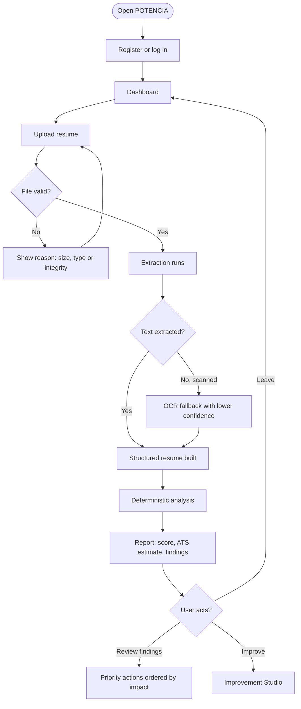
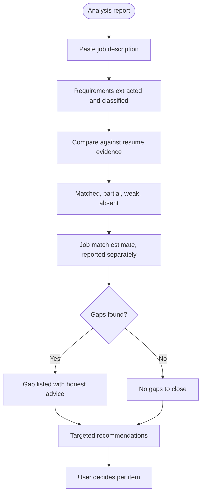
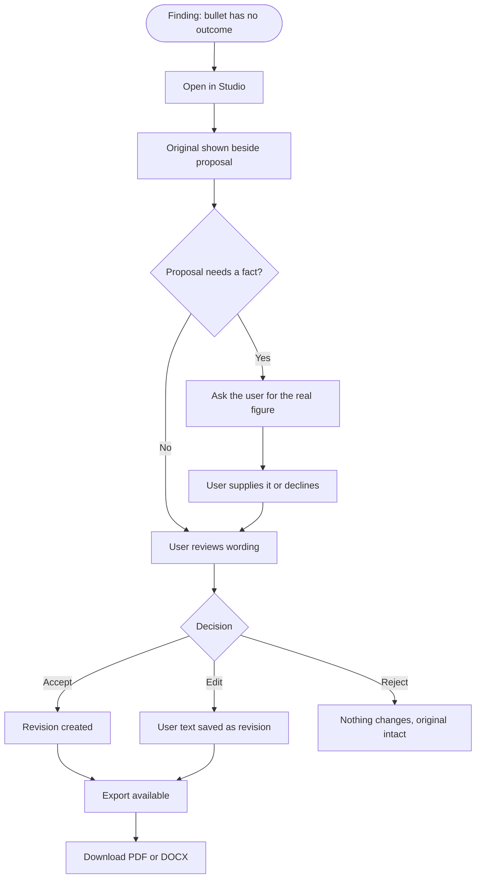
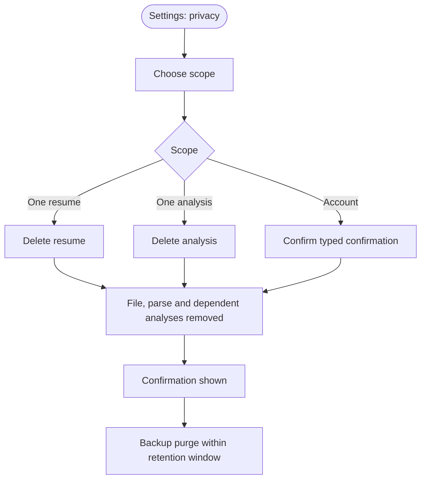

# POTENCIA — Software Requirements Specification

**Version:** `1.0`
**Status:** specification, Phase 1. Implements nothing; constrains everything.
**Normative dependencies:** [`API.md`](API.md) (wire format), [`SCORING_METHODOLOGY.md`](SCORING_METHODOLOGY.md) (score arithmetic).
**Author:** Arghya Bose

---

## 1. Purpose, scope and normative status

This document defines what POTENCIA must do and how well it must do it. It is the acceptance basis for Phases 2–16: a phase is complete when the requirements it owns are demonstrably satisfied, not when the code looks finished.

### 1.1 Normative language

`MUST` — mandatory for v1. A phase carrying a `MUST` requirement cannot exit while that requirement fails.
`SHOULD` — expected; omitting it requires a written justification in `PROJECT_STATUS.md`.
`COULD` — optional; may be deferred without justification.

### 1.2 Precedence

Where documents disagree, the more specific one governs:

1. `API.md` governs wire format and status codes.
2. `SCORING_METHODOLOGY.md` governs any number the product displays.
3. This document governs behaviour, quality targets and scope.

Nothing in the frontend may override any of the three.

### 1.3 Scope

An AI-assisted resume intelligence platform: a candidate uploads a resume, receives a structured, evidence-backed evaluation of its content, structure, ATS parseability and fit to a target role, improves it under explicit approval, and exports the result. Delivered as a versioned REST API consumed by a single-page web application. English-language documents only in v1.

---

## 2. Product vision

POTENCIA answers five questions honestly, and refuses to answer any of them dishonestly:

| # | Question | Answered by | May NOT be answered by |
|:-:|:--|:--|:--|
| 01 | How strong is this resume? | Deterministic scoring engine | An LLM's opinion |
| 02 | How reliably can ATS-style software read it? | ATS compatibility engine (estimate) | A vendor simulation claim |
| 03 | How well does it match a target role? | Job matching engine | Keyword-count guessing |
| 04 | What is reducing its effectiveness? | Criterion findings with cited evidence | Generic advice |
| 05 | What should change, in what order? | Priority actions ordered by score impact | Unsolicited rewriting |

The product's differentiator is not AI. It is **verifiability**: every number is reproducible, every claim cites a line of the user's own document, and every suggestion is one the user can check for truthfulness before accepting it.

---

## 3. Target users

Each persona states its goals, its constraints, and what failure looks like — because a product that fails a student by judging them as a mid-career professional has failed, even if the score is "correct".

### 3.1 Student (pre-graduation, no employment history)

| Dimension | Description |
|:--|:--|
| **Context** | Applying to first internships; has coursework, academic projects, maybe one club role |
| **Goals** | Understand whether the resume is worth sending at all; learn what a "good" bullet looks like |
| **Constraints** | No quantified business outcomes to cite; may have no experience section whatsoever |
| **Failure** | Being scored 0 on experience for not having a career yet, or being told to add metrics that do not exist |
| **Product obligation** | `experience` becomes **not applicable**, `applicable_weight` drops, and the reason is stated plainly |

### 3.2 Fresher / internship seeker (0–2 years, recent graduate)

| Dimension | Description |
|:--|:--|
| **Context** | Internships, freelance or open-source work; competing on volume of applications |
| **Goals** | Find the specific weaknesses causing silence; tailor to each posting quickly |
| **Constraints** | Thin experience; skills list is often a keyword wall with no supporting evidence |
| **Failure** | Being encouraged to add skills to match a job description they cannot actually do |
| **Product obligation** | `SK-04` verifiability must produce "substantiate or remove" advice, never "add" advice |

### 3.3 Experienced professional (5+ years)

| Dimension | Description |
|:--|:--|
| **Context** | Multiple roles, real outcomes, possibly a poorly maintained document |
| **Goals** | Confirm the resume is not quietly costing opportunities; tighten it, not rewrite it |
| **Constraints** | No time; low tolerance for generic advice; strong attachment to their own phrasing |
| **Failure** | Being told the obvious, or having a good bullet rewritten into vagueness |
| **Product obligation** | Edits are opt-in per item; the original is immutable; nothing is auto-applied |

### 3.4 Career switcher

| Dimension | Description |
|:--|:--|
| **Context** | Strong domain history, weak alignment with the target role's vocabulary |
| **Goals** | Translate existing experience into the target field's terms without lying |
| **Constraints** | Genuinely lacks some required skills; must not be nudged to claim them |
| **Failure** | A high match score produced by keyword overlap with work they never did |
| **Product obligation** | `JobMatch` must keep `absent`, `weakly_demonstrated` and `matched` as distinct states |

### 3.5 Shared obligations across personas

- The product never assumes seniority. Page expectations (`ST-04`) and section ordering (`ST-02`) use derived seniority, not a default.
- The product never infers facts about a person's life from a gap in a document. Gaps are surfaced (`EX-02`), not explained away.
- The product never compares a user to other users (benchmarking is out of scope, §9).

---

## 4. User journeys

### 4.1 First analysis

### 4.2 Job-targeted analysis

### 4.3 Fixing one weak bullet

### 4.4 Deleting all personal data

---

## 5. Functional requirements

Priority: **M** = Must, **S** = Should, **C** = Could.
Each acceptance criterion is stated so that a test can pass or fail it.

### Module A — Document Processing

| ID | Requirement | Pri | Acceptance criterion |
|:--|:--|:-:|:--|
| FR-A-01 | Accept PDF and DOCX resume uploads via `POST /api/v1/resumes` | M | Valid PDF returns `201` with `status: "queued"`; valid DOCX likewise; body is `multipart/form-data` field `file` |
| FR-A-02 | Reject uploads larger than 5 MiB before parsing | M | 6 MiB file returns `413` with `error.code: "payload_too_large"`; no parser is invoked (verified by spy) |
| FR-A-03 | Validate file type by magic bytes, never by extension alone | M | A text file renamed `.pdf` returns `415 unsupported_media_type`; a real PDF renamed `.docx` returns `415` |
| FR-A-04 | Reject encrypted, macro-bearing and archive-bomb inputs | M | Encrypted PDF returns `422 file_rejected`; ZIP bomb returns `422` without exhausting memory (bounded extraction test) |
| FR-A-05 | Extract text preserving page boundaries and paragraph order | M | For each text-layer fixture, `page_count` matches the source and extracted text contains every heading in document order |
| FR-A-06 | Detect scanned documents and use OCR only as a fallback | M | Image-only fixture yields `extraction.ocr_used: true` and a non-empty `extraction.warnings`; a text-layer fixture yields `ocr_used: false` |
| FR-A-07 | Record extraction confidence in `[0,1]` per document | M | Every `Resume` response contains `extraction.confidence`; value is strictly lower for a scanned fixture than its text-layer equivalent |
| FR-A-08 | Identify sections and map headings to canonical kinds | M | Every heading lands in a `sections[]` entry; unmatched headings are `kind: "other"` and are never dropped |
| FR-A-09 | Surface undetermined fields as uncertain rather than guessed | M | A fixture with an ambiguous date produces a `structure.uncertain` entry naming that field; the field itself is `null` |
| FR-A-10 | Record warnings whenever extraction degrades | M | No response may carry `extraction.method: "partial"` or `"ocr"` with an empty `warnings` array |
| FR-A-11 | Deleting a resume removes its file, parse and dependent analyses | M | After `DELETE /resumes/{id}`, the file blob is gone from storage and `GET /analyses?resume_id=` returns zero items |

### Module B — Resume Intelligence

| ID | Requirement | Pri | Acceptance criterion |
|:--|:--|:-:|:--|
| FR-B-01 | Extract contact details: email, phone, profile links | M | Fixture with all three yields all three populated; fixture missing a phone yields `phone: null` — never a placeholder |
| FR-B-02 | Extract experience entries with title, organisation and dates | M | Each role yields `title`, `organisation`, `start`, `end`, `date_precision`; ongoing roles use `end: null` with `date_precision: "present"` |
| FR-B-03 | Extract education, projects, certifications, achievements and leadership | M | Each of the five, when present in a fixture, yields a populated `sections[]` entry of the correct `kind` |
| FR-B-04 | Distinguish explicit skills from skills inferred from experience | M | `skills.explicit` contains only terms stated as skills; `skills.inferred[]` entries each carry a non-empty `basis` string |
| FR-B-05 | Canonicalise skills against a versioned taxonomy | M | `JS` and `JavaScript` normalise to one canonical entry; the taxonomy content hash is persisted with the resume |
| FR-B-06 | Normalise dates and flag ambiguity instead of resolving it silently | M | `Mar 2024` and `2024-03` both normalise to `2024-03`; `03/04/2024` is flagged `date_ambiguous` in `uncertain` |
| FR-B-07 | Extract keywords with their source spans | M | Every keyword resolves to a character span that, re-sliced from the source text, contains the keyword |
| FR-B-08 | Never create an entity absent from the source document | M | Traceability test: for every populated leaf in `structure`, its supporting span exists in the source text; synthetic fixture with no employer yields zero experience entries |

### Module C — ATS Compatibility

| ID | Requirement | Pri | Acceptance criterion |
|:--|:--|:-:|:--|
| FR-C-01 | Produce an ATS compatibility estimate for every completed analysis | M | Every completed analysis contains an `ats` object with `estimate` in `[0,100]` |
| FR-C-02 | Ship a disclaimer inside the payload, not only in the UI | M | `ats.disclaimer` is present, non-empty, and mentions that it is an estimate in every response |
| FR-C-03 | Report checks for extraction, reading order, hazards, dates and contact parseability | M | A report on a text-layer single-column fixture contains at least one check covering each of those five areas |
| FR-C-04 | Detect image-only text and mark extraction as failing | M | Scanned fixture yields an `ATS` check with `status: "fail"` naming extraction |
| FR-C-05 | Detect multi-column layout and read-order risk | M | Two-column fixture yields a `warn` or `fail` check citing columns; single-column fixture does not |
| FR-C-06 | Detect contact details that live only in headers/footers or images | M | Fixture with the email only in a page header yields a check flagging it |
| FR-C-07 | Report ATS findings with a locator and a remediation | M | Every check carries `evidence` with a page or text locator and a non-empty `remediation` |
| FR-C-08 | Keep document parseability separate from job keyword relevance | M | No `ats` payload contains job-description keywords, and `job_match` contains no document-structure data |
| FR-C-09 | Count checks consistently in `summary` | M | `summary.pass + summary.warn + summary.fail` equals `len(checks)` in every report |

### Module D — Scoring Engine

| ID | Requirement | Pri | Acceptance criterion |
|:--|:--|:-:|:--|
| FR-D-01 | Compute the six intrinsic categories and the overall score per `SCORING_METHODOLOGY.md` v1.0.0 | M | Worked example in §10 of that document reproduces exactly: `overall: 77.5` on the stated fixture |
| FR-D-02 | **An LLM must never produce, adjust or influence a numeric score** | M | With every AI provider disabled or returning garbage, the produced `scores` object is byte-identical to the run with providers healthy |
| FR-D-03 | Scoring must be deterministic | M | Scoring the same fixture twice yields identical values to one decimal place; a fixed expected-JSON snapshot test passes |
| FR-D-04 | Report `applicable_weight` and exclude non-applicable categories from the denominator | M | Student fixture with no work history reports no `experience` component and `applicable_weight: 80` |
| FR-D-05 | Treat missing-but-expected sections as `0.0` with a `high` severity finding | M | Experienced fixture with no Skills section reports `skills` near `0.0` plus a finding citing the absence |
| FR-D-06 | Attach criterion ID, verbatim evidence and `score_impact` to every deduction | M | Every finding generated by the engine has `criterion`, a non-empty `evidence[]` whose text occurs verbatim in the source, and a numeric `score_impact` |
| FR-D-07 | Make findings reconcile with the score | M | `Σ|score_impact|` equals `100 − overall` within ±0.1 on every fixture |
| FR-D-08 | Round once, to one decimal place | M | All reported values have at most one decimal; no double-rounding artefacts across 100 fixture runs |
| FR-D-09 | Prevent double penalties | M | Criterion `property` ownership is unique; a unit test asserts no duplicate property is registered |
| FR-D-10 | Store the methodology version and clause-library hashes with each analysis | M | Every stored analysis row carries `methodology_version` and the hashes used at scoring time |
| FR-D-11 | Never re-score a stored analysis implicitly | M | Changing the methodology does not alter any previously stored score; re-scoring requires an explicit request |

### Module E — Job Description Matching

| ID | Requirement | Pri | Acceptance criterion |
|:--|:--|:-:|:--|
| FR-E-01 | Accept, list, retrieve and delete job descriptions | M | Full CRUD against `/api/v1/jobs`; `title` and `company` are optional; `description` is required |
| FR-E-02 | Extract and classify requirements: required skills, preferred skills, experience, education, responsibilities, certifications | M | A fixture posting with all six yields all six populated; a posting with no preferred skills yields an empty list, not invented entries |
| FR-E-03 | Keep four distinct requirement states | M | `matched`, `partial`, `weakly_demonstrated`, `absent` each appear where the fixture justifies it; no state is merged into another |
| FR-E-04 | Aggregate the match estimate deterministically | M | Repeating the match on the same resume and posting yields an identical `estimate` |
| FR-E-05 | Never blend match into overall resume quality | M | `scores.overall` is identical with and without a job description for the same resume; `job_match` appears only as its own object |
| FR-E-06 | Never advise adding a skill the resume does not evidence | M | Every `gaps[].advice` for an `absent` requirement is phrased as "do not add unless true"; a test rejects any advice containing an instruction to add an unsupported skill name |
| FR-E-07 | Distinguish unstated from unsupported | M | A requirement met only implicitly (semantic, no literal keyword) is `weakly_demonstrated`, never `matched` |
| FR-E-08 | Ignore unrelated keyword occurrences | M | A posting requiring `Go` does not match a resume whose only occurrence is the English verb "go" |

### Module F — AI Recommendation Engine

| ID | Requirement | Pri | Acceptance criterion |
|:--|:--|:-:|:--|
| FR-F-01 | Cover the ten recommendation categories defined in `API.md` §2.9 | M | Each category has a fixture producing at least one recommendation of that category |
| FR-F-02 | Include original text, proposal, reason, priority, finding link and confidence in every recommendation | M | Schema validation rejects any recommendation missing one of those six fields |
| FR-F-03 | Never introduce facts absent from the original text | M | Entity/proper-noun set of `proposed_text` is a subset of the source resume's; a fixture containing an invented employer fails the test |
| FR-F-04 | Ask for missing metrics rather than inventing them | M | A bullet with no metric yields `requires_user_input` populated and a `proposed_text` containing no numeral absent from the source |
| FR-F-05 | Validate every model response against a schema before persisting | M | A malformed provider response produces zero stored recommendations and a logged, sanitised failure |
| FR-F-06 | Treat document text as data, never as instructions | M | Adversarial fixtures containing instruction-like text ("ignore previous instructions...") produce no behaviour change; a test asserts the system prompt is unaffected |
| FR-F-07 | Degrade gracefully when the AI provider is unavailable | M | With the provider failing, the analysis still completes with deterministic findings and `ats`; recommendations are marked unavailable and `retryable` |
| FR-F-08 | Version prompts and record the version used | M | Every stored recommendation references the prompt version that generated it |
| FR-F-09 | Never send unnecessary personal data to an external provider | M | Provider request logs show email and phone redacted; the raw file binary is never transmitted |

### Module G — Resume Improvement Studio

| ID | Requirement | Pri | Acceptance criterion |
|:--|:--|:-:|:--|
| FR-G-01 | Support accept, reject and edit decisions per recommendation | M | `POST /recommendations/{id}/decision` with each enum value updates `state` accordingly |
| FR-G-02 | Require replacement text when the decision is `edit` | M | `decision: "edit"` without `edited_text` returns `422 validation_error` |
| FR-G-03 | Keep decisions idempotent | M | Replaying an identical decision returns `200` with the current state; no duplicate revision is created |
| FR-G-04 | Preserve an immutable original and a revision tree | M | Revision 0 always equals the initial parse; every later revision has a `parent_id`; no revision row is ever updated in place |
| FR-G-05 | Never auto-apply generated content | M | No code path writes generated text into a revision without an explicit user decision |
| FR-G-06 | Detect concurrent-edit conflicts | M | Two revisions created from the same `parent_id` where the second is based on stale content returns `409 conflict` |
| FR-G-07 | Support undo without mutating history | M | Undo creates a new revision whose content equals the earlier revision; both remain readable |
| FR-G-08 | Preserve factual content across an accepted edit | M | Applying a recommendation replaces only the targeted span; every other field of the structure is unchanged (deep-equality test) |
| FR-G-09 | Provide side-by-side original and proposed text | M | Studio returns both `original_text` and the current proposed/edited text for every pending item |

### Module H — Analysis Dashboard

| ID | Requirement | Pri | Acceptance criterion |
|:--|:--|:-:|:--|
| FR-H-01 | Display overall score, component breakdown, ATS estimate, job match and findings | M | All five render from a single `GET /analyses/{id}` response, values matching the API payload exactly |
| FR-H-02 | Display strengths, weaknesses and priority actions | M | Strengths render with their evidence; priority actions are ordered by descending score impact |
| FR-H-03 | Never render hardcoded or fixture analysis data in production paths | M | A grep-level test asserts no literal score object exists outside test fixtures |
| FR-H-04 | Handle loading, empty, error and retry states on every data view | M | Each view has an exercised error path with a working retry control |
| FR-H-05 | Display confidence and flag low-confidence results | M | Any `confidence: "low"` component renders a visible warning adjacent to its score |
| FR-H-06 | Communicate that the score is an estimate with a version | M | The methodology version is visible on the report, not buried in a tooltip |
| FR-H-07 | Be responsive at mobile, tablet and desktop | M | Layout is usable at 375 px, 768 px and 1440 px without horizontal scrolling or overlapping controls |
| FR-H-08 | Meet WCAG 2.1 AA for interactive flows | M | Automated axe pass with zero violations of level A/AA on every page; keyboard-only completion of upload → report |
| FR-H-09 | Ship no non-functional controls | M | Every button, link and form control is wired to a real operation or is visibly disabled with a reason |

### Module I — Reports and Export

| ID | Requirement | Pri | Acceptance criterion |
|:--|:--|:-:|:--|
| FR-I-01 | Export analysis reports and improved resumes as PDF and DOCX | M | All four combinations of `kind` × `format` produce a downloadable file |
| FR-I-02 | Authorize downloads with short-lived, single-user links | M | `download_url` expires in 15 minutes; a link used by another user returns `404` |
| FR-I-03 | Verify generated documents programmatically | M | Tests reopen each generated file, extract its text and assert the approved content is present and in section order |
| FR-I-04 | Exclude rejected content from exports | M | A rejected recommendation's text never appears in the exported resume |
| FR-I-05 | Keep long resumes readable | M | A 4-page fixture exports with no clipped text, no overlapping elements and preserved section hierarchy |
| FR-I-06 | Preserve the user's approved wording verbatim | M | Exported text matches the approved revision content character-for-character for each exported field |
| FR-I-07 | Never expose internal storage paths or provider URLs | M | No export response contains a filesystem path or provider hostname |

### Module J — Accounts and Data Management

| ID | Requirement | Pri | Acceptance criterion |
|:--|:--|:-:|:--|
| FR-J-01 | Register and log in with securely hashed passwords | M | Password is stored only as a memory-hard hash; a database dump contains no plaintext or reversible representation |
| FR-J-02 | Enforce a minimum password length of 12 characters | M | An 11-character password returns `422 validation_error` |
| FR-J-03 | Prevent account enumeration | M | Unknown email and wrong password return identical status, message and response timing within measurement noise |
| FR-J-04 | Issue short-lived access tokens with rotating refresh tokens | M | Access token TTL is 15 minutes; a reused refresh token returns `401` and revokes the family |
| FR-J-05 | Deny cross-user access without revealing existence | M | User B requesting User A's resume receives `404 not_found`, never `403` |
| FR-J-06 | Let users delete a resume, an analysis, or their whole account | M | Each deletion returns `204` and the object is unreachable afterwards |
| FR-J-07 | Expose paginated resume and analysis history | M | Cursor pagination returns `has_more: false` on the last page; `limit` above 100 is rejected |
| FR-J-08 | Rate limit per user | M | Exceeding a route's limit returns `429` with `Retry-After` and the standard error envelope |
| FR-J-09 | Revoke tokens on logout | M | After logout the presented refresh token cannot mint a new access token |

### Cross-cutting functional requirements

| ID | Requirement | Pri | Acceptance criterion |
|:--|:--|:-:|:--|
| FR-X-01 | Version the API in the path | M | All business routes live under `/api/v1`; only `/health` sits outside |
| FR-X-02 | Return the standard error envelope on every non-2xx | M | A contract test asserts the envelope shape for each documented error code |
| FR-X-03 | Guard mutating collection endpoints with an idempotency key | M | Replaying a key returns the original response with `Idempotency-Replayed: true` |
| FR-X-04 | Echo a `request_id` on every response | M | `X-Request-ID` is present on success and failure responses and appears in logs |
| FR-X-05 | Report dependency health without crashing | M | With the database down, `GET /health` returns `503` with `dependencies.database: "unavailable"` while the process stays up |

---

## 6. Non-functional requirements

All numeric targets below are **design targets**, defined by this specification. They are not measured results and must not be presented as benchmarks until Phase 15 measures them.

| ID | Area | Requirement | Measurable target |
|:--|:--|:--|:--|
| NFR-01 | Performance | Health check responds promptly under normal load | p95 ≤ 100 ms server-side |
| NFR-02 | Performance | Upload acceptance is fast; extraction is asynchronous | p95 ≤ 2 s for `POST /resumes` acceptance (excluding extraction) |
| NFR-03 | Performance | Analysis completes within a usable window | p95 ≤ 60 s for a ≤ 5-page text-layer resume including recommendation generation |
| NFR-04 | Performance | Export generation completes | p95 ≤ 30 s per document |
| NFR-05 | Scalability | Concurrent analysis without degradation | 50 concurrent analyses complete with p95 ≤ 2× NFR-03 and zero unhandled errors |
| NFR-06 | Reliability | No unhandled exception reaches a client | 0 responses with an unhandled traceback across the full test suite; 100 % of failures return the §1.4 envelope |
| NFR-07 | Security | Authentication and access control meet a recognised baseline | OWASP ASVS Level 2 for authentication, session management and access control; zero unresolved critical/high findings at Phase 13 exit |
| NFR-08 | Security | Every endpoint enforces ownership | 100 % of resource routes have an automated cross-user denial test |
| NFR-09 | Privacy | Resume content never reaches logs | Log-scrubbing test: 0 occurrences of source resume text, filenames, emails or tokens in captured logs for the full fixture suite |
| NFR-10 | Privacy | Deletion is real | Data unreachable immediately after deletion; backups purged within 30 days (design target) |
| NFR-11 | Accessibility | Interface is usable with assistive technology | WCAG 2.1 AA; 0 axe violations of level A/AA on every page; all interactive elements keyboard reachable with visible focus |
| NFR-12 | Observability | Every request is traceable | 100 % of requests emit one structured JSON log line with `request_id`, route, status, duration and user id; no PII fields |
| NFR-13 | Maintainability | Module boundaries are enforced, not conventional | Import-rule test fails if `document/` depends on `intelligence/`, or any module outside `ai/` imports a provider SDK |
| NFR-14 | Maintainability | Intelligence logic is covered by tests | ≥ 80 % line coverage for `document/`, `intelligence/` and `ai/`; 100 % of scoring criteria have at least one fixture |
| NFR-15 | Portability | Clean-clone startup | `docker compose up` from a fresh clone reaches a healthy stack with no host dependency beyond Docker |
| NFR-16 | Reproducibility | Builds are pinned | Dependency versions locked; identical lockfile yields an identical environment |
| NFR-17 | Reproducibility | Scores do not drift | Determinism test: same fixture and methodology version produce identical score JSON across runs and machines |
| NFR-18 | Compatibility | Supported browsers | Current and previous major versions of Chrome, Firefox, Safari and Edge; no support for Internet Explorer |
| NFR-19 | Usability | Time to first result | A new user reaches a completed analysis in ≤ 3 minutes including registration and upload (design target) |

---

## 7. Data and privacy requirements

### 7.1 Classification and retention

| Data | Classification | Retention (design target) | Deletion trigger |
|:--|:--|:--|:--|
| Account credentials | Sensitive | Life of account | Account deletion |
| Uploaded original file | Sensitive personal | Until deleted, or 90 days after last account activity | User delete; account delete; inactivity purge |
| Extracted text and structure | Sensitive personal | Tied to the resume | Cascade with resume |
| Analyses, findings, scores | Personal | Until deleted, or with the resume | User delete; resume delete; account delete |
| Recommendations and revisions | Personal | With the resume | Cascade |
| Generated exports | Personal | 24 hours | Automatic expiry |
| Auth and audit logs | Operational | 90 days | Rolling purge |
| Structured request logs | Operational | 30 days | Rolling purge |

### 7.2 Absolute prohibitions

| ID | Prohibition |
|:--|:--|
| DP-01 | Resume text, job description text, filenames, emails, phone numbers and tokens MUST NOT appear in any log, metric label or trace span |
| DP-02 | An uploaded resume MUST NOT be publicly reachable, indexed, or served from a guessable URL |
| DP-03 | No user's data may be readable by another user, under any endpoint, including through caching |
| DP-04 | Derived results MUST NOT be cached across users |
| DP-05 | Raw document binaries MUST NOT be transmitted to an external AI provider |
| DP-06 | Email and phone MUST be redacted before any external AI call |
| DP-07 | The original parse (revision 0) MUST NOT be mutable, overwritten, or replaced by generated content |
| DP-08 | Deletion MUST NOT be a soft flag that leaves records readable by the operator through the API |

### 7.3 User-facing rights

- **Explain:** every score must be traceable to criteria and evidence the user can read.
- **Correct:** the user may override any extracted field; their correction takes precedence over the parse.
- **Delete:** per-resume, per-analysis and whole-account deletion are all available without contacting support.
- **Withdraw:** disabling AI-assisted recommendations must remain possible while deterministic analysis continues to work.

---

## 8. Constraints and assumptions

### 8.1 Constraints

| ID | Constraint | Consequence |
|:--|:--|:--|
| C-01 | Numeric scores are deterministic and rule-based | An LLM cannot improve a score; product quality depends on criterion design, not model choice |
| C-02 | English-language documents only in v1 | Non-English input must be rejected or clearly marked as unsupported, not silently mis-scored |
| C-03 | Uploads capped at 5 MiB | Larger documents are rejected with a clear reason |
| C-04 | ATS vendors are proprietary and not modelled | Only an estimate can be produced; vendor-specific simulation is out of scope |
| C-05 | No model training or fine-tuning in v1 | Capability is bounded by the taxonomy, rules and prompts |
| C-06 | Single-region deployment in v1 | No cross-region data residency guarantees |
| C-07 | The scoring weights are unvalidated hypotheses | Every display of them must be labelled as such until §9 calibration of the methodology document is complete |

### 8.2 Assumptions

| ID | Assumption | If false |
|:--|:--|:--|
| A-01 | The user owns, or is authorised to upload, the resume | Uploading others' documents would create a consent defect; the product assumes the former and states it at upload |
| A-02 | Resumes are predominantly text-based PDFs and DOCX | OCR volume rises, confidence falls, and results must degrade visibly |
| A-03 | A job description, when supplied, is the user's actual target role | Matching quality is meaningless against an unrelated posting |
| A-04 | Users can recognise their own facts | Quantification prompts assume the user knows their real numbers |
| A-05 | Docker is available in the development and deployment environment | Host-native database setup becomes a manual prerequisite |

### 8.3 Claims explicitly not made

The product MUST NOT state, imply, or allow a client to imply:

| ID | Non-claim |
|:--|:--|
| NC-01 | That a resume will pass any ATS, or be read correctly by a specific vendor's system |
| NC-02 | That the user will receive an interview, offer or callback |
| NC-03 | That any score is comparable to another vendor's score, or to the same product's score under a different methodology version |
| NC-04 | Any accuracy, correlation or predictive-validity figure before the calibration in `SCORING_METHODOLOGY.md` §9 has been performed and the dataset, split and interval are published alongside it |
| NC-05 | That the scoring weights are industry standards |
| NC-06 | That a recommendation is factually correct solely because a model produced it |

---

## 9. Out of scope for v1

| Excluded capability | Reason |
|:--|:--|
| Multilingual resume analysis | English-only parsing and taxonomy; a half-working second language is worse than an explicit boundary |
| Recruiter / employer tools | A different user, a different threat model, and the candidate's consent problem is unsolved in v1 |
| Benchmarking against other candidates | Requires a representative, consented, anonymised corpus that does not exist yet; publishing a benchmark without one would be fabrication |
| Resume version management across roles | Useful, but multiplies the surface before the core loop is proven |
| Career-path and skill-development intelligence | Depends on labour-market data outside this product's scope |
| Job board or application automation | Out of product scope entirely |
| Automated applications or auto-submission | Would take consequential action on the user's behalf without review |
| Model training or fine-tuning | Not justified until measurement shows the current architecture cannot meet a requirement |
| Native mobile applications | The responsive web application covers the need in v1 |

---

## 10. Traceability

| Module | Implementing phase | Internal specification | External contract |
|:--|:-:|:--|:--|
| Foundation, health, infrastructure | 2 | `ARCHITECTURE.md` | `API.md` §3.1 |
| J — Accounts and data | 3 | `ARCHITECTURE.md`, `SECURITY.md` (Phase 13) | `API.md` §3.2, §3.3 |
| A — Document processing | 4 | `ARCHITECTURE.md` | `API.md` §2.3, §2.4, §3.3 |
| B — Resume intelligence | 5 | `ARCHITECTURE.md` | `API.md` §2.4 |
| D — Scoring engine | 6 | `SCORING_METHODOLOGY.md` | `API.md` §2.5, §2.6, §3.4 |
| C — ATS compatibility | 7 | `SCORING_METHODOLOGY.md` §4.5 | `API.md` §2.7 |
| E — Job matching | 8 | `SCORING_METHODOLOGY.md` | `API.md` §2.8, §3.5, §3.6 |
| F — Recommendations | 9 | `ARCHITECTURE.md`, prompt registry | `API.md` §2.9, §3.7 |
| G — Improvement Studio | 10 | `ARCHITECTURE.md` | `API.md` §2.10, §3.3, §3.7 |
| H — Dashboard | 11 | `ARCHITECTURE.md` | `API.md` §2.5–§2.8, §3.4 |
| I — Reports and export | 12 | `ARCHITECTURE.md` | `API.md` §2.11, §3.8 |
| Security and privacy | 13 | `SECURITY.md` | §7 of this document |
| Testing and QA | 14 | `TESTING.md` | all acceptance criteria |
| Performance and reliability | 15 | `TESTING.md` | NFR-01 … NFR-05 |
| Deployment | 16 | `DEPLOYMENT.md` | NFR-15, NFR-16 |

### 10.1 Requirement-to-phase gate

A phase may not exit while any `M` requirement it owns fails its acceptance criterion. Where a requirement depends on a later phase (for example FR-C-01 depending on parser output), the requirement is satisfied by that later phase and the dependency is recorded rather than assumed.

---

## 11. Definition of done for v1

The specification is satisfied when, on a clean deployment:

1. A new user registers, uploads a resume and receives an analysis without encountering an unhandled error.
2. Every displayed number is reproducible from a stored methodology version and reconciles with its findings.
3. Every score component shows its confidence, and low confidence is visibly flagged.
4. A job description produces a separated match estimate with four distinct requirement states.
5. A user improves at least one item, sees the original preserved, and exports a verified document.
6. A user deletes their account and the data is gone.
7. Every `M` requirement in §5 has a passing automated test.
8. No requirement in §8.3 has been contradicted anywhere in the product surface.
